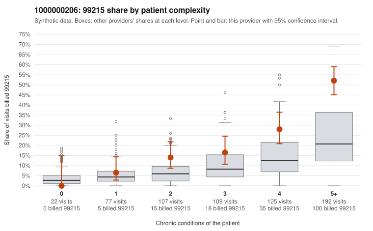

# 1000000206: 1000000206: documented 99215 claims mostly support the level billed (0% below)

**Leaning (advisory):** Pattern consistent with a high-acuity panel

## Why

1000000206 billed 99215 on 27.4% of 632 claims against an expected 11.0% given patient complexity (risk-adjusted score 5.14; plain z-score vs peers 3.69). 3% of this provider's 99215 claims were on patients with 0 or 1 chronic conditions. Records came back for 20 claims. Of 6 documented 99215 claims, 0 (0%) were documented below the billed level, against 20% for the comparison providers. Note checks on 20 returned notes (share showing each sign): problems 10%, late 0%, unsigned 0%, data 0%. No audit trail was received. 0 of 19 notes claiming moderate-or-higher data reviewed had no lab or test line on the claim. This pattern is consistent with a high-acuity panel. The sampled documentation supports the billed level. Examples: C0105537: billed 99215; documented MDM level high, minutes not recorded. C0105941: billed 99215; documented MDM level high, 43 minutes. C0106002: billed 99215; documented MDM level high, minutes not recorded. C0105523: billed 99215, patient aged 19 with 4 chronic condition(s) (obesity;hyperlipidemia;depression;hypertension). C0105531: billed 99215, patient aged 45 with 5 chronic condition(s) (type 2 diabetes;obesity;hypertension;COPD;asthma).

## Evidence chart

## Cited claims

`C0105537`, `C0105941`, `C0106002`, `C0105523`, `C0105531`

## Suggested next steps

- Do not pursue recovery on this evidence: 20 charts came back and they support the level billed (0 of 6 documented 99215 claims below the billed level).
- Revisit if the 99215 share keeps rising against peers or a larger sample shows unsupported claims.

---
Citations checked: 5/5 valid. Synthetic data. The leaning is advisory; the flag comes from the statistical screen, and no clinical documentation is available beyond the sampled records-review facts shown in the packet.
