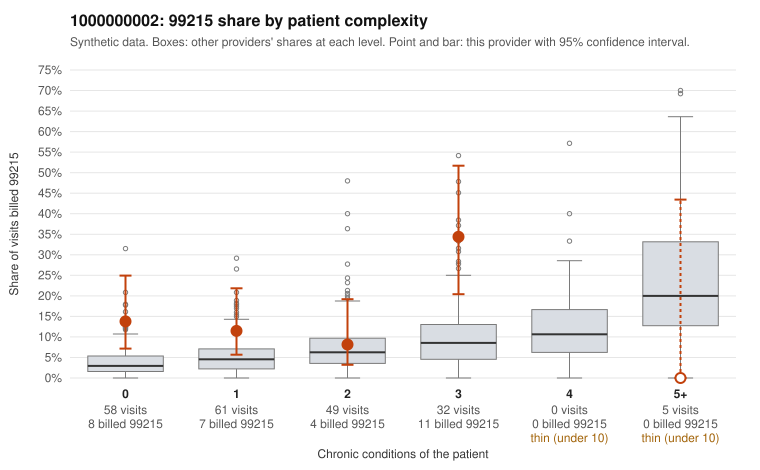

# 1000000002: 1000000002: too few returned records to judge

**Leaning (advisory):** Inconclusive

## Why

1000000002 billed 99215 on 14.6% of 205 claims against an expected 5.0% given patient complexity (risk-adjusted score 2.51; plain z-score vs peers 1.43). 50% of this provider's 99215 claims were on patients with 0 or 1 chronic conditions. Records came back for 30 claims. Of 6 documented 99215 claims, 2 (33%) were documented below the billed level, against 41% for the comparison providers. Note checks on 30 returned notes (share showing each sign): problems 40%, late 3%, unsigned 0%, data 0%, bulk created 0%, paste heavy 0%. 1 of 18 notes claiming moderate-or-higher data reviewed had no lab or test line on the claim. The evidence does not support a call either way yet. Examples: C0000248: billed 99215, patient aged 46 with 0 chronic condition(s); documented MDM level moderate, minutes not recorded. C0000285: billed 99215, patient aged 46 with 1 chronic condition(s) (obesity); documented MDM level moderate, minutes not recorded. C0000185: billed 99215, patient aged 46 with 0 chronic condition(s). C0000197: billed 99215, patient aged 49 with 0 chronic condition(s).

## Evidence chart

## Cited claims

`C0000248`, `C0000285`, `C0000185`, `C0000197`

## Suggested next steps

- 30 charts came back but do not settle it: request a targeted sample of 99215 charts, starting with C0000248, C0000285, C0000185.
- Re-check after the targeted charts arrive; do not call upcoding or a sicker panel on this evidence alone.

---
Citations checked: 4/4 valid. Synthetic data. The leaning is advisory; the flag comes from the statistical screen, and no clinical documentation is available beyond the sampled records-review facts shown in the packet.
