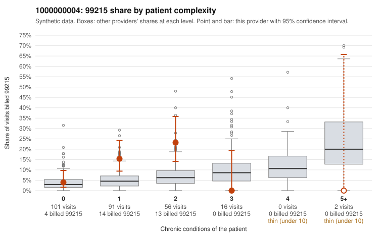

# 1000000004: 1000000004: too few returned records to judge

**Leaning (advisory):** Inconclusive

## Why

1000000004 billed 99215 on 11.7% of 266 claims against an expected 4.3% given patient complexity (risk-adjusted score 2.34; plain z-score vs peers 0.86). 58% of this provider's 99215 claims were on patients with 0 or 1 chronic conditions. Records came back for 44 claims. Of 16 documented 99215 claims, 4 (25%) were documented below the billed level, against 41% for the comparison providers. Note checks on 44 returned notes (share showing each sign): problems 39%, late 4%, unsigned 0%, data 7%, bulk created 0%, paste heavy 0%. 3 of 33 notes claiming moderate-or-higher data reviewed had no lab or test line on the claim. The evidence does not support a call either way yet. Examples: C0001544: billed 99215, patient aged 42 with 1 chronic condition(s) (COPD); documented MDM level moderate, minutes not recorded. C0001635: billed 99215, patient aged 48 with 0 chronic condition(s); documented MDM level moderate, minutes not recorded. C0001470: billed 99215, patient aged 25 with 1 chronic condition(s) (COPD). C0001472: billed 99215, patient aged 66 with 1 chronic condition(s) (type 2 diabetes).

## Evidence chart

## Cited claims

`C0001544`, `C0001635`, `C0001470`, `C0001472`

## Suggested next steps

- 44 charts came back but do not settle it: request a targeted sample of 99215 charts, starting with C0001544, C0001635, C0001470.
- Re-check after the targeted charts arrive; do not call upcoding or a sicker panel on this evidence alone.

---
Citations checked: 4/4 valid. Synthetic data. The leaning is advisory; the flag comes from the statistical screen, and no clinical documentation is available beyond the sampled records-review facts shown in the packet.
