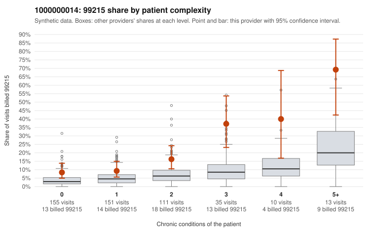

# 1000000014: 1000000014: too few returned records to judge

**Leaning (advisory):** Inconclusive

## Why

1000000014 billed 99215 on 14.9% of 475 claims against an expected 4.8% given patient complexity (risk-adjusted score 4.23; plain z-score vs peers 1.49). 38% of this provider's 99215 claims were on patients with 0 or 1 chronic conditions. Records came back for 45 claims. Of 19 documented 99215 claims, 2 (10%) were documented below the billed level, against 41% for the comparison providers. Note checks on 45 returned notes (share showing each sign): problems 24%, late 0%, unsigned 0%, data 9%. No audit trail was received. 5 of 35 notes claiming moderate-or-higher data reviewed had no lab or test line on the claim. The evidence does not support a call either way yet. Examples: C0005968: billed 99215, patient aged 60 with 0 chronic condition(s); documented MDM level moderate, 33 minutes. C0006022: billed 99215, patient aged 32 with 0 chronic condition(s); documented MDM level moderate, 32 minutes. C0005573: billed 99215, patient aged 56 with 1 chronic condition(s) (hypertension). C0005589: billed 99215, patient aged 62 with 1 chronic condition(s) (hypertension).

## Evidence chart

## Cited claims

`C0005968`, `C0006022`, `C0005573`, `C0005589`

## Suggested next steps

- 45 charts came back but do not settle it: request a targeted sample of 99215 charts, starting with C0005968, C0006022, C0005573.
- Re-check after the targeted charts arrive; do not call upcoding or a sicker panel on this evidence alone.

---
Citations checked: 4/4 valid. Synthetic data. The leaning is advisory; the flag comes from the statistical screen, and no clinical documentation is available beyond the sampled records-review facts shown in the packet.
