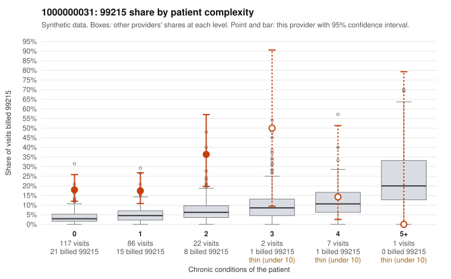

# 1000000031: 1000000031: 0 of 7 documented 99215 claims (0%) are documented below the billed level

**Leaning (advisory):** Pattern consistent with upcoding

## Why

1000000031 billed 99215 on 19.6% of 235 claims against an expected 3.9% given patient complexity (risk-adjusted score 5.12; plain z-score vs peers 2.38). 78% of this provider's 99215 claims were on patients with 0 or 1 chronic conditions. Records came back for 24 claims. Of 7 documented 99215 claims, 0 (0%) were documented below the billed level, against 41% for the comparison providers. Note checks on 24 returned notes (share showing each sign): problems 62%, late 21%, unsigned 0%, data 17%, bulk created 21%, paste heavy 29%. 5 of 13 notes claiming moderate-or-higher data reviewed had no lab or test line on the claim. This pattern is consistent with upcoding. It is a reason to review the records, not a finding. Examples: C0018362: billed 99215, patient aged 45 with 0 chronic condition(s). C0018363: billed 99215, patient aged 64 with 1 chronic condition(s) (obesity). C0018387: billed 99215, patient aged 76 with 1 chronic condition(s) (obesity).

## Evidence chart

## Cited claims

`C0018362`, `C0018363`, `C0018387`

## Suggested next steps

- Request the full charts for C0018362, C0018363, C0018387 and have a certified coder re-score each against the current E/M rules (medical decision making or total time).
- If the re-scoring confirms the pattern, review the random sample in the recovery packet's sampling plan before any overpayment estimate; do not extrapolate from a targeted sample.
- Look at the notes themselves: 62% address fewer problems than their level implies and 21% were signed late; request the audit trail for C0018362, C0018363, C0018387.

---
Citations checked: 3/3 valid. Synthetic data. The leaning is advisory; the flag comes from the statistical screen, and no clinical documentation is available beyond the sampled records-review facts shown in the packet.
