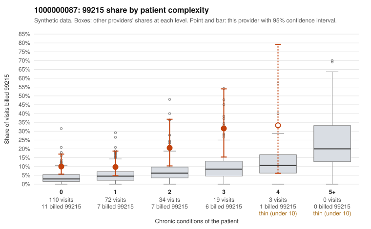

# 1000000087: 1000000087: too few returned records to judge

**Leaning (advisory):** Inconclusive

## Why

1000000087 billed 99215 on 13.4% of 238 claims against an expected 4.1% given patient complexity (risk-adjusted score 2.90; plain z-score vs peers 1.20). 56% of this provider's 99215 claims were on patients with 0 or 1 chronic conditions. Records came back for 44 claims. Of 18 documented 99215 claims, 11 (61%) were documented below the billed level, against 41% for the comparison providers. Note checks on 44 returned notes (share showing each sign): problems 23%, late 4%, unsigned 0%, data 2%. No audit trail was received. 2 of 27 notes claiming moderate-or-higher data reviewed had no lab or test line on the claim. The evidence does not support a call either way yet. Examples: C0052242: billed 99215, patient aged 22 with 0 chronic condition(s); documented MDM level moderate, 30 minutes. C0052350: billed 99215, patient aged 59 with 0 chronic condition(s); documented MDM level moderate, 39 minutes. C0052204: billed 99215, patient aged 44 with 1 chronic condition(s) (heart failure). C0052210: billed 99215, patient aged 35 with 1 chronic condition(s) (osteoarthritis).

## Evidence chart

## Cited claims

`C0052242`, `C0052350`, `C0052204`, `C0052210`

## Suggested next steps

- 44 charts came back but do not settle it: request a targeted sample of 99215 charts, starting with C0052242, C0052350, C0052204.
- Re-check after the targeted charts arrive; do not call upcoding or a sicker panel on this evidence alone.

---
Citations checked: 4/4 valid. Synthetic data. The leaning is advisory; the flag comes from the statistical screen, and no clinical documentation is available beyond the sampled records-review facts shown in the packet.
