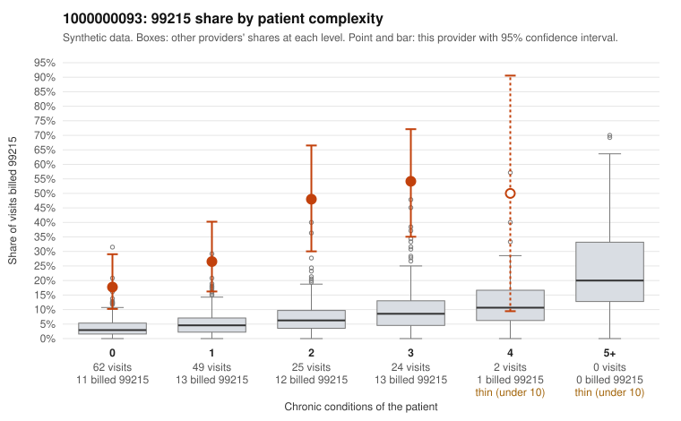

# 1000000093: 1000000093: too few returned records to judge

**Leaning (advisory):** Inconclusive

## Why

1000000093 billed 99215 on 30.9% of 162 claims against an expected 4.4% given patient complexity (risk-adjusted score 6.77; plain z-score vs peers 4.54). 48% of this provider's 99215 claims were on patients with 0 or 1 chronic conditions. Records came back for 45 claims. Of 22 documented 99215 claims, 4 (18%) were documented below the billed level, against 41% for the comparison providers. Note checks on 45 returned notes (share showing each sign): problems 36%, late 7%, unsigned 0%, data 2%, bulk created 0%, paste heavy 0%. 3 of 37 notes claiming moderate-or-higher data reviewed had no lab or test line on the claim. The evidence does not support a call either way yet. Examples: C0055160: billed 99215; documented MDM level moderate, minutes not recorded. C0055197: billed 99215, patient aged 56 with 1 chronic condition(s) (osteoarthritis); documented MDM level moderate, 38 minutes. C0055169: billed 99215, patient aged 62 with 1 chronic condition(s) (type 2 diabetes); documented MDM level high, 54 minutes. C0055180: billed 99215, patient aged 52 with 1 chronic condition(s) (hyperlipidemia).

## Evidence chart

## Cited claims

`C0055160`, `C0055197`, `C0055169`, `C0055180`

## Suggested next steps

- 45 charts came back but do not settle it: request a targeted sample of 99215 charts, starting with C0055160, C0055197, C0055169.
- Re-check after the targeted charts arrive; do not call upcoding or a sicker panel on this evidence alone.

---
Citations checked: 4/4 valid. Synthetic data. The leaning is advisory; the flag comes from the statistical screen, and no clinical documentation is available beyond the sampled records-review facts shown in the packet.
