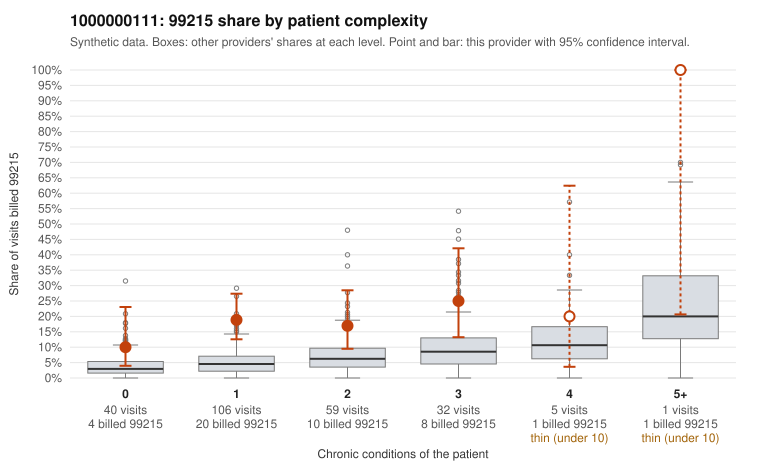

# 1000000111: 1000000111: 0 of 7 documented 99215 claims (0%) are documented below the billed level

**Leaning (advisory):** Pattern consistent with upcoding

## Why

1000000111 billed 99215 on 18.1% of 243 claims against an expected 4.9% given patient complexity (risk-adjusted score 3.90; plain z-score vs peers 2.10). 55% of this provider's 99215 claims were on patients with 0 or 1 chronic conditions. Records came back for 30 claims. Of 7 documented 99215 claims, 0 (0%) were documented below the billed level, against 41% for the comparison providers. Note checks on 30 returned notes (share showing each sign): problems 40%, late 20%, unsigned 0%, data 27%, bulk created 20%, paste heavy 13%. 8 of 23 notes claiming moderate-or-higher data reviewed had no lab or test line on the claim. This pattern is consistent with upcoding. It is a reason to review the records, not a finding. Examples: C0062039: billed 99213; documented MDM level straightforward, minutes not recorded. C0062089: billed 99214; documented MDM level low, minutes not recorded. C0061949: billed 99215, patient aged 30 with 1 chronic condition(s) (obesity). C0061964: billed 99215, patient aged 27 with 1 chronic condition(s) (COPD); documented MDM level high, 44 minutes. C0061977: billed 99215, patient aged 45 with 0 chronic condition(s).

## Evidence chart

## Cited claims

`C0062039`, `C0062089`, `C0061949`, `C0061964`, `C0061977`

## Suggested next steps

- Request the full charts for C0062039, C0062089, C0061949 and have a certified coder re-score each against the current E/M rules (medical decision making or total time).
- If the re-scoring confirms the pattern, review the random sample in the recovery packet's sampling plan before any overpayment estimate; do not extrapolate from a targeted sample.
- Look at the notes themselves: 40% address fewer problems than their level implies and 20% were signed late; request the audit trail for C0062039, C0062089, C0061949.

---
Citations checked: 5/5 valid. Synthetic data. The leaning is advisory; the flag comes from the statistical screen, and no clinical documentation is available beyond the sampled records-review facts shown in the packet.
