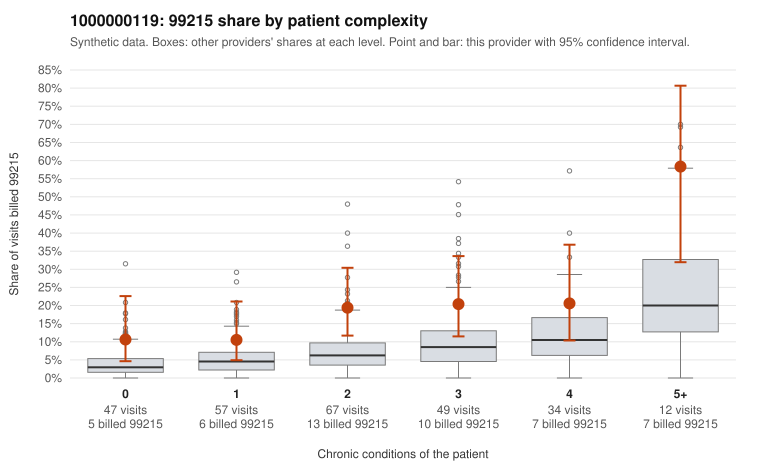

# 1000000119: 1000000119: documented 99215 claims mostly support the level billed (14% below)

**Leaning (advisory):** Pattern consistent with a high-acuity panel

## Why

1000000119 billed 99215 on 18.0% of 266 claims against an expected 6.2% given patient complexity (risk-adjusted score 3.21; plain z-score vs peers 2.08). 23% of this provider's 99215 claims were on patients with 0 or 1 chronic conditions. Records came back for 30 claims. Of 7 documented 99215 claims, 1 (14%) were documented below the billed level, against 41% for the comparison providers. Note checks on 30 returned notes (share showing each sign): problems 20%, late 3%, unsigned 0%, data 3%. No audit trail was received. 2 of 22 notes claiming moderate-or-higher data reviewed had no lab or test line on the claim. This pattern is consistent with a high-acuity panel. The sampled documentation supports the billed level. Examples: C0064748: billed 99215; documented MDM level high, minutes not recorded. C0064789: billed 99215; documented MDM level high, minutes not recorded. C0064976: billed 99215; documented MDM level high, minutes not recorded. C0064808: billed 99215, patient aged 86 with 5 chronic condition(s) (type 2 diabetes;hyperlipidemia;COPD;asthma;chronic kidney disease). C0064811: billed 99215, patient aged 80 with 4 chronic condition(s) (obesity;hyperlipidemia;depression;hypertension).

## Evidence chart

## Cited claims

`C0064748`, `C0064789`, `C0064976`, `C0064808`, `C0064811`

## Suggested next steps

- Do not pursue recovery on this evidence: 30 charts came back and they support the level billed (1 of 7 documented 99215 claims below the billed level).
- Revisit if the 99215 share keeps rising against peers or a larger sample shows unsupported claims.

---
Citations checked: 5/5 valid. Synthetic data. The leaning is advisory; the flag comes from the statistical screen, and no clinical documentation is available beyond the sampled records-review facts shown in the packet.
