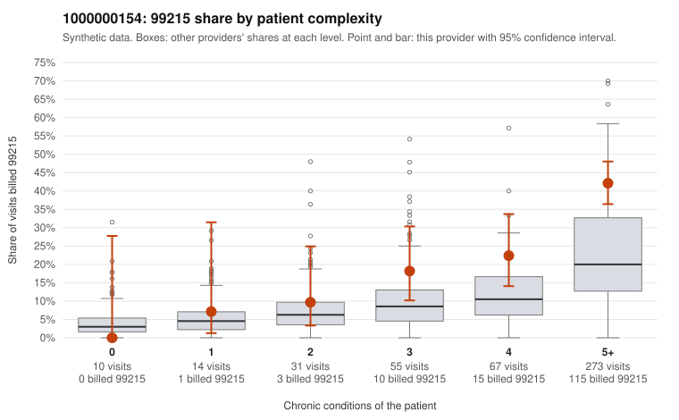

# 1000000154: 1000000154: documented 99215 claims mostly support the level billed (15% below)

**Leaning (advisory):** Pattern consistent with a high-acuity panel

## Why

1000000154 billed 99215 on 32.0% of 450 claims against an expected 14.2% given patient complexity (risk-adjusted score 4.47; plain z-score vs peers 4.75). 1% of this provider's 99215 claims were on patients with 0 or 1 chronic conditions. Records came back for 45 claims. Of 20 documented 99215 claims, 3 (15%) were documented below the billed level, against 41% for the comparison providers. Note checks on 45 returned notes (share showing each sign): problems 2%, late 2%, unsigned 0%, data 9%. No audit trail was received. 4 of 40 notes claiming moderate-or-higher data reviewed had no lab or test line on the claim. This pattern is consistent with a high-acuity panel. The sampled documentation supports the billed level. Examples: C0084103: billed 99215; documented MDM level high, 54 minutes. C0084151: billed 99215, patient aged 73 with 4 chronic condition(s) (type 2 diabetes;hyperlipidemia;depression;hypertension); documented MDM level high, 42 minutes. C0084320: billed 99215; documented MDM level high, 35 minutes. C0084020: billed 99215, patient aged 76 with 5 chronic condition(s) (hypothyroidism;type 2 diabetes;hyperlipidemia;depression;atrial fibrillation). C0084093: billed 99215, patient aged 75 with 4 chronic condition(s) (type 2 diabetes;obesity;atrial fibrillation;asthma).

## Evidence chart

## Cited claims

`C0084103`, `C0084151`, `C0084320`, `C0084020`, `C0084093`

## Suggested next steps

- Do not pursue recovery on this evidence: 45 charts came back and they support the level billed (3 of 20 documented 99215 claims below the billed level).
- Revisit if the 99215 share keeps rising against peers or a larger sample shows unsupported claims.

---
Citations checked: 5/5 valid. Synthetic data. The leaning is advisory; the flag comes from the statistical screen, and no clinical documentation is available beyond the sampled records-review facts shown in the packet.
