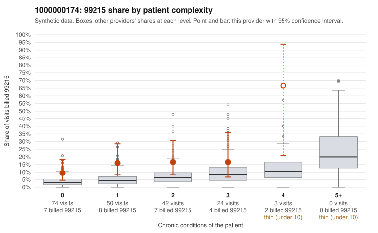

# 1000000174: 1000000174: too few returned records to judge

**Leaning (advisory):** Inconclusive

## Why

1000000174 billed 99215 on 14.5% of 193 claims against an expected 4.5% given patient complexity (risk-adjusted score 2.67; plain z-score vs peers 1.41). 54% of this provider's 99215 claims were on patients with 0 or 1 chronic conditions. Records came back for 14 claims. Of 2 documented 99215 claims, 0 (0%) were documented below the billed level, against 41% for the comparison providers. Note checks on 14 returned notes (share showing each sign): problems 29%, late 0%, unsigned 0%, data 7%. No audit trail was received. 1 of 11 notes claiming moderate-or-higher data reviewed had no lab or test line on the claim. The evidence does not support a call either way yet. Examples: C0091250: billed 99215, patient aged 38 with 1 chronic condition(s) (hyperlipidemia). C0091302: billed 99215, patient aged 53 with 0 chronic condition(s).

## Evidence chart

## Cited claims

`C0091250`, `C0091302`

## Suggested next steps

- 14 charts came back but do not settle it: request a targeted sample of 99215 charts, starting with C0091250, C0091302.
- Re-check after the targeted charts arrive; do not call upcoding or a sicker panel on this evidence alone.

---
Citations checked: 2/2 valid. Synthetic data. The leaning is advisory; the flag comes from the statistical screen, and no clinical documentation is available beyond the sampled records-review facts shown in the packet.
