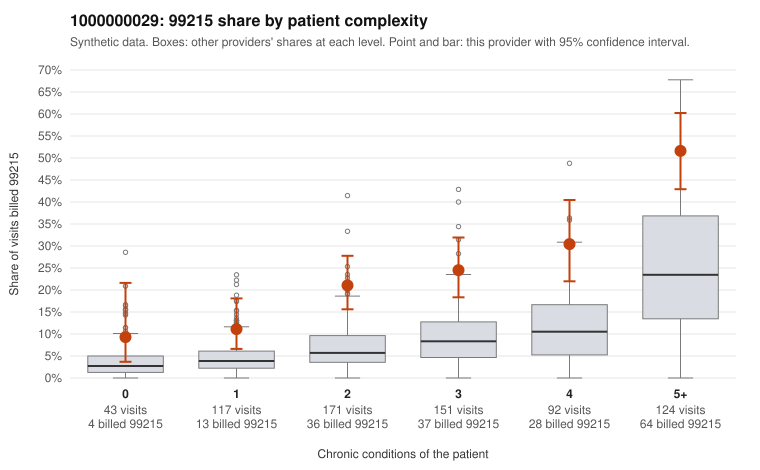

# 1000000029: 1000000029: documented 99215 claims mostly support the level billed (0% below)

**Leaning (advisory):** Pattern consistent with a high-acuity panel

## Why

1000000029 billed 99215 on 26.1% of 698 claims against an expected 9.6% given patient complexity (risk-adjusted score 6.32; plain z-score vs peers 3.51). 9% of this provider's 99215 claims were on patients with 0 or 1 chronic conditions. Records came back for 30 claims. Of 10 documented 99215 claims, 0 (0%) were documented below the billed level, against 22% for the comparison providers. Note checks on 30 returned notes (share showing each sign): problems 10%, late 0%, unsigned 0%, data 10%. No audit trail was received. 3 of 22 notes claiming moderate-or-higher data reviewed had no lab or test line on the claim. This pattern is consistent with a high-acuity panel. The sampled documentation supports the billed level. Examples: C0010389: billed 99215; documented MDM level high, minutes not recorded. C0010453: billed 99215; documented MDM level high, 48 minutes. C0010936: billed 99215, patient aged 57 with 4 chronic condition(s) (hypothyroidism;type 2 diabetes;obesity;heart failure); documented MDM level high, 54 minutes. C0010296: billed 99215, patient aged 52 with 4 chronic condition(s) (depression;hypertension;COPD;osteoarthritis). C0010316: billed 99215, patient aged 71 with 4 chronic condition(s) (obesity;hyperlipidemia;atrial fibrillation;chronic kidney disease).

## Evidence chart

## Cited claims

`C0010389`, `C0010453`, `C0010936`, `C0010296`, `C0010316`

## Suggested next steps

- Do not pursue recovery on this evidence: 30 charts came back and they support the level billed (0 of 10 documented 99215 claims below the billed level).
- Revisit if the 99215 share keeps rising against peers or a larger sample shows unsupported claims.

---
Citations checked: 5/5 valid. Synthetic data. The leaning is advisory; the flag comes from the statistical screen, and no clinical documentation is available beyond the sampled records-review facts shown in the packet.
