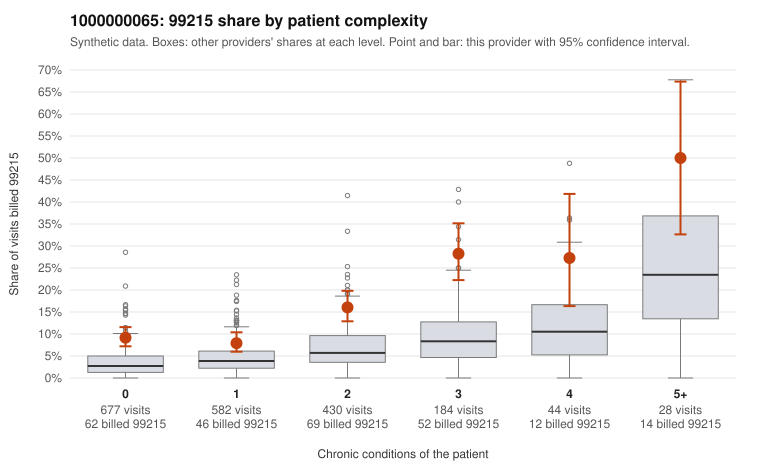

# 1000000065: 1000000065: too few returned records to judge

**Leaning (advisory):** Inconclusive

## Why

1000000065 billed 99215 on 13.1% of 1,945 claims against an expected 4.8% given patient complexity (risk-adjusted score 7.23; plain z-score vs peers 1.14). 42% of this provider's 99215 claims were on patients with 0 or 1 chronic conditions. Records came back for 45 claims. Of 18 documented 99215 claims, 6 (33%) were documented below the billed level, against 22% for the comparison providers. Note checks on 45 returned notes (share showing each sign): problems 38%, late 4%, unsigned 0%, data 0%. No audit trail was received. 1 of 32 notes claiming moderate-or-higher data reviewed had no lab or test line on the claim. The evidence does not support a call either way yet. Examples: C0025781: billed 99215; documented MDM level moderate, 30 minutes. C0026247: billed 99215; documented MDM level moderate, 38 minutes. C0025827: billed 99215, patient aged 63 with 1 chronic condition(s) (obesity). C0025850: billed 99215, patient aged 60 with 1 chronic condition(s) (hypertension).

## Evidence chart

## Cited claims

`C0025781`, `C0026247`, `C0025827`, `C0025850`

## Suggested next steps

- 45 charts came back but do not settle it: request a targeted sample of 99215 charts, starting with C0025781, C0026247, C0025827.
- Re-check after the targeted charts arrive; do not call upcoding or a sicker panel on this evidence alone.

---
Citations checked: 4/4 valid. Synthetic data. The leaning is advisory; the flag comes from the statistical screen, and no clinical documentation is available beyond the sampled records-review facts shown in the packet.
