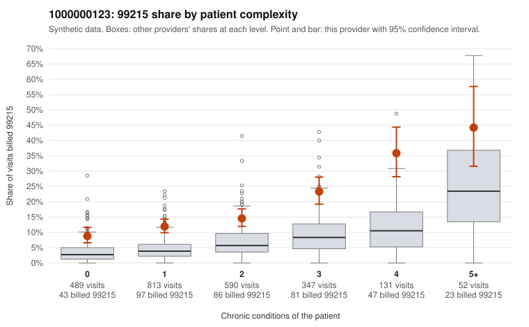

# 1000000123: 1000000123: documented 99215 claims mostly support the level billed (6% below)

**Leaning (advisory):** Pattern consistent with a high-acuity panel

## Why

1000000123 billed 99215 on 15.6% of 2,422 claims against an expected 5.5% given patient complexity (risk-adjusted score 9.06; plain z-score vs peers 1.59). 37% of this provider's 99215 claims were on patients with 0 or 1 chronic conditions. Records came back for 21 claims. Of 17 documented 99215 claims, 1 (6%) were documented below the billed level, against 22% for the comparison providers. Note checks on 21 returned notes (share showing each sign): problems 33%, late 5%, unsigned 0%, data 5%. No audit trail was received. 1 of 19 notes claiming moderate-or-higher data reviewed had no lab or test line on the claim. This pattern is consistent with a high-acuity panel. The sampled documentation supports the billed level. Examples: C0060626: billed 99215; documented MDM level high, 50 minutes. C0061853: billed 99215; documented MDM level high, 46 minutes. C0062273: billed 99215; documented MDM level high, 40 minutes. C0060543: billed 99215, patient aged 36 with 4 chronic condition(s) (hyperlipidemia;hypertension;COPD;chronic kidney disease). C0060910: billed 99215, patient aged 83 with 4 chronic condition(s) (type 2 diabetes;hyperlipidemia;depression;osteoarthritis).

## Evidence chart

## Cited claims

`C0060626`, `C0061853`, `C0062273`, `C0060543`, `C0060910`

## Suggested next steps

- Do not pursue recovery on this evidence: 21 charts came back and they support the level billed (1 of 17 documented 99215 claims below the billed level).
- Revisit if the 99215 share keeps rising against peers or a larger sample shows unsupported claims.

---
Citations checked: 5/5 valid. Synthetic data. The leaning is advisory; the flag comes from the statistical screen, and no clinical documentation is available beyond the sampled records-review facts shown in the packet.
