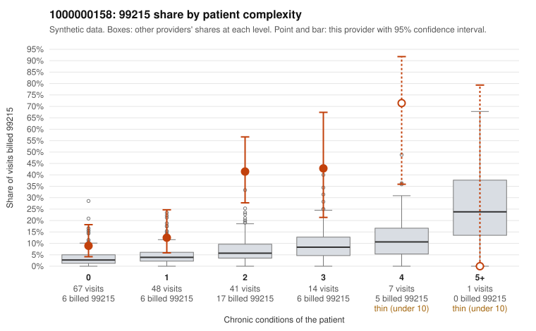

# 1000000158: 1000000158: too few returned records to judge

**Leaning (advisory):** Inconclusive

## Why

1000000158 billed 99215 on 22.5% of 178 claims against an expected 4.7% given patient complexity (risk-adjusted score 4.73; plain z-score vs peers 2.85). 30% of this provider's 99215 claims were on patients with 0 or 1 chronic conditions. Records came back for 30 claims. Of 9 documented 99215 claims, 4 (44%) were documented below the billed level, against 22% for the comparison providers. Note checks on 30 returned notes (share showing each sign): problems 27%, late 10%, unsigned 0%, data 3%. No audit trail was received. 1 of 21 notes claiming moderate-or-higher data reviewed had no lab or test line on the claim. The evidence does not support a call either way yet. Examples: C0081759: billed 99215; documented MDM level moderate, 20 minutes. C0081808: billed 99215, patient aged 48 with 1 chronic condition(s) (type 2 diabetes); documented MDM level moderate, minutes not recorded. C0081764: billed 99215, patient aged 29 with 0 chronic condition(s). C0081805: billed 99215, patient aged 53 with 1 chronic condition(s) (type 2 diabetes).

## Evidence chart

## Cited claims

`C0081759`, `C0081808`, `C0081764`, `C0081805`

## Suggested next steps

- 30 charts came back but do not settle it: request a targeted sample of 99215 charts, starting with C0081759, C0081808, C0081764.
- Re-check after the targeted charts arrive; do not call upcoding or a sicker panel on this evidence alone.

---
Citations checked: 4/4 valid. Synthetic data. The leaning is advisory; the flag comes from the statistical screen, and no clinical documentation is available beyond the sampled records-review facts shown in the packet.
