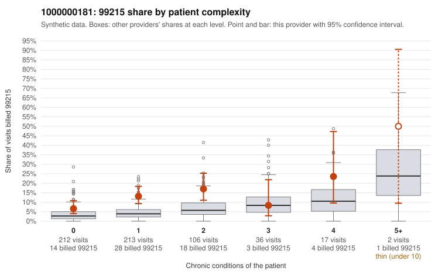

# 1000000181: 1000000181: too few returned records to judge

**Leaning (advisory):** Inconclusive

## Why

1000000181 billed 99215 on 11.6% of 586 claims against an expected 4.4% given patient complexity (risk-adjusted score 3.59; plain z-score vs peers 0.86). 62% of this provider's 99215 claims were on patients with 0 or 1 chronic conditions. Records came back for 45 claims. Of 17 documented 99215 claims, 5 (29%) were documented below the billed level, against 22% for the comparison providers. Note checks on 45 returned notes (share showing each sign): problems 36%, late 4%, unsigned 0%, data 9%, bulk created 0%, paste heavy 0%. 4 of 33 notes claiming moderate-or-higher data reviewed had no lab or test line on the claim. The evidence does not support a call either way yet. Examples: C0093108: billed 99215; documented MDM level moderate, minutes not recorded. C0093131: billed 99215, patient aged 36 with 0 chronic condition(s); documented MDM level moderate, 35 minutes. C0092976: billed 99215, patient aged 48 with 0 chronic condition(s). C0093041: billed 99215, patient aged 52 with 1 chronic condition(s) (depression).

## Evidence chart

## Cited claims

`C0093108`, `C0093131`, `C0092976`, `C0093041`

## Suggested next steps

- 45 charts came back but do not settle it: request a targeted sample of 99215 charts, starting with C0093108, C0093131, C0092976.
- Re-check after the targeted charts arrive; do not call upcoding or a sicker panel on this evidence alone.

---
Citations checked: 4/4 valid. Synthetic data. The leaning is advisory; the flag comes from the statistical screen, and no clinical documentation is available beyond the sampled records-review facts shown in the packet.
