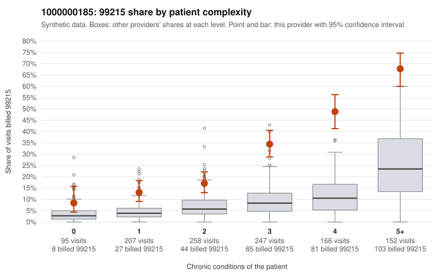

# 1000000185: 1000000185: too few returned records to judge

**Leaning (advisory):** Inconclusive

## Why

1000000185 billed 99215 on 30.9% of 1,125 claims against an expected 8.8% given patient complexity (risk-adjusted score 11.12; plain z-score vs peers 4.40). 10% of this provider's 99215 claims were on patients with 0 or 1 chronic conditions. Records came back for 30 claims. Of 7 documented 99215 claims, 1 (14%) were documented below the billed level, against 22% for the comparison providers. Note checks on 30 returned notes (share showing each sign): problems 7%, late 7%, unsigned 0%, data 7%. No audit trail was received. 2 of 26 notes claiming moderate-or-higher data reviewed had no lab or test line on the claim. The evidence does not support a call either way yet. Examples: C0094874: billed 99215, patient aged 84 with 1 chronic condition(s) (hypertension); documented MDM level moderate, minutes not recorded. C0094288: billed 99215, patient aged 59 with 1 chronic condition(s) (hypothyroidism). C0094347: billed 99215, patient aged 38 with 1 chronic condition(s) (chronic kidney disease).

## Evidence chart

## Cited claims

`C0094874`, `C0094288`, `C0094347`

## Suggested next steps

- 30 charts came back but do not settle it: request a targeted sample of 99215 charts, starting with C0094874, C0094288, C0094347.
- Re-check after the targeted charts arrive; do not call upcoding or a sicker panel on this evidence alone.

---
Citations checked: 3/3 valid. Synthetic data. The leaning is advisory; the flag comes from the statistical screen, and no clinical documentation is available beyond the sampled records-review facts shown in the packet.
