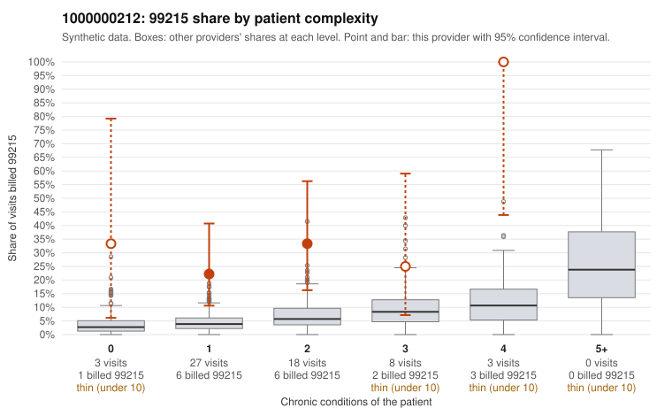

# 1000000212: 1000000212: too few returned records to judge

**Leaning (advisory):** Inconclusive

## Why

1000000212 billed 99215 on 30.5% of 59 claims against an expected 5.3% given patient complexity (risk-adjusted score 3.60; plain z-score vs peers 4.33). 39% of this provider's 99215 claims were on patients with 0 or 1 chronic conditions. Records came back for 30 claims. Of 9 documented 99215 claims, 0 (0%) were documented below the billed level, against 22% for the comparison providers. Note checks on 30 returned notes (share showing each sign): problems 33%, late 3%, unsigned 0%, data 7%. No audit trail was received. 4 of 24 notes claiming moderate-or-higher data reviewed had no lab or test line on the claim. The evidence does not support a call either way yet. Examples: C0113176: billed 99213; documented MDM level straightforward, minutes not recorded. C0113204: billed 99213; documented MDM level straightforward, minutes not recorded. C0113185: billed 99215, patient aged 65 with 1 chronic condition(s) (hyperlipidemia). C0113186: billed 99215, patient aged 38 with 1 chronic condition(s) (type 2 diabetes).

## Evidence chart

## Cited claims

`C0113176`, `C0113204`, `C0113185`, `C0113186`

## Suggested next steps

- 30 charts came back but do not settle it: request a targeted sample of 99215 charts, starting with C0113176, C0113204, C0113185.
- Re-check after the targeted charts arrive; do not call upcoding or a sicker panel on this evidence alone.

---
Citations checked: 4/4 valid. Synthetic data. The leaning is advisory; the flag comes from the statistical screen, and no clinical documentation is available beyond the sampled records-review facts shown in the packet.
