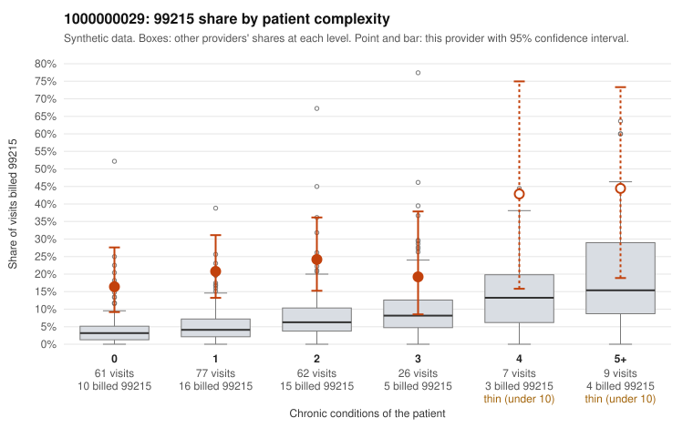

# 1000000029: 1000000029: 0 of 6 documented 99215 claims (0%) are documented below the billed level

**Leaning (advisory):** Pattern consistent with upcoding

## Why

1000000029 billed 99215 on 21.9% of 242 claims against an expected 5.3% given patient complexity (risk-adjusted score 4.57; plain z-score vs peers 2.24). 49% of this provider's 99215 claims were on patients with 0 or 1 chronic conditions. Records came back for 30 claims. Of 6 documented 99215 claims, 0 (0%) were documented below the billed level, against 31% for the comparison providers. Note checks on 30 returned notes (share showing each sign): problems 30%, late 27%, unsigned 0%, data 27%, bulk created 13%, paste heavy 13%. 10 of 17 notes claiming moderate-or-higher data reviewed had no lab or test line on the claim. This pattern is consistent with upcoding. It is a reason to review the records, not a finding. Examples: C0019315: billed 99215, patient aged 52 with 1 chronic condition(s) (osteoarthritis). C0019322: billed 99215, patient aged 54 with 1 chronic condition(s) (type 2 diabetes). C0019327: billed 99215, patient aged 73 with 1 chronic condition(s) (hypothyroidism).

## Evidence chart

## Cited claims

`C0019315`, `C0019322`, `C0019327`

## Suggested next steps

- Request the full charts for C0019315, C0019322, C0019327 and have a certified coder re-score each against the current E/M rules (medical decision making or total time).
- If the re-scoring confirms the pattern, review the random sample in the recovery packet's sampling plan before any overpayment estimate; do not extrapolate from a targeted sample.
- Look at the notes themselves: 30% address fewer problems than their level implies and 27% were signed late; request the audit trail for C0019315, C0019322, C0019327.

---
Citations checked: 3/3 valid. Synthetic data. The leaning is advisory; the flag comes from the statistical screen, and no clinical documentation is available beyond the sampled records-review facts shown in the packet.
