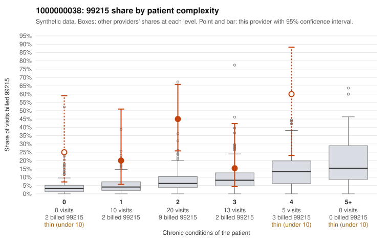

# 1000000038: 1000000038: too few returned records to judge

**Leaning (advisory):** Inconclusive

## Why

1000000038 billed 99215 on 32.1% of 56 claims against an expected 5.8% given patient complexity (risk-adjusted score 3.26; plain z-score vs peers 3.81). 22% of this provider's 99215 claims were on patients with 0 or 1 chronic conditions. Records came back for 30 claims. Of 10 documented 99215 claims, 1 (10%) were documented below the billed level, against 31% for the comparison providers. Note checks on 30 returned notes (share showing each sign): problems 10%, late 7%, unsigned 0%, data 3%. No audit trail was received. 2 of 23 notes claiming moderate-or-higher data reviewed had no lab or test line on the claim. The evidence does not support a call either way yet. Examples: C0024977: billed 99215; documented MDM level moderate, 36 minutes. C0024936: billed 99215, patient aged 40 with 0 chronic condition(s); documented MDM level high, minutes not recorded. C0024945: billed 99215, patient aged 34 with 0 chronic condition(s); documented MDM level high, minutes not recorded.

## Evidence chart

## Cited claims

`C0024977`, `C0024936`, `C0024945`

## Suggested next steps

- 30 charts came back but do not settle it: request a targeted sample of 99215 charts, starting with C0024977, C0024936, C0024945.
- Re-check after the targeted charts arrive; do not call upcoding or a sicker panel on this evidence alone.

---
Citations checked: 3/3 valid. Synthetic data. The leaning is advisory; the flag comes from the statistical screen, and no clinical documentation is available beyond the sampled records-review facts shown in the packet.
