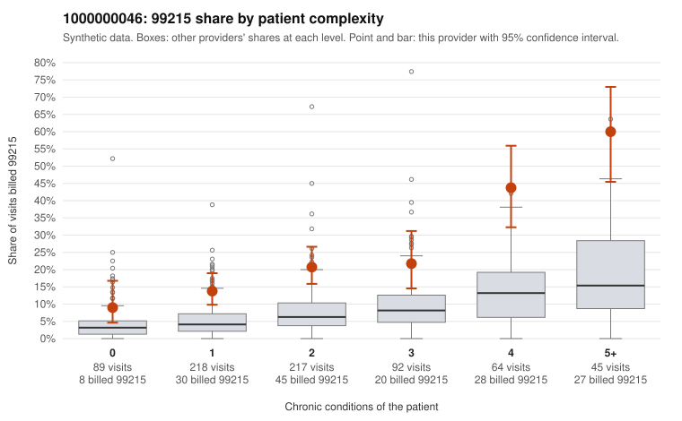

# 1000000046: 1000000046: too few returned records to judge

**Leaning (advisory):** Inconclusive

## Why

1000000046 billed 99215 on 21.8% of 725 claims against an expected 6.3% given patient complexity (risk-adjusted score 6.83; plain z-score vs peers 2.22). 24% of this provider's 99215 claims were on patients with 0 or 1 chronic conditions. Records came back for 45 claims. Of 19 documented 99215 claims, 2 (10%) were documented below the billed level, against 31% for the comparison providers. Note checks on 45 returned notes (share showing each sign): problems 36%, late 2%, unsigned 0%, data 0%, bulk created 0%, paste heavy 0%. 4 of 32 notes claiming moderate-or-higher data reviewed had no lab or test line on the claim. The evidence does not support a call either way yet. Examples: C0028599: billed 99215; documented MDM level moderate, minutes not recorded. C0028670: billed 99215; documented MDM level moderate, minutes not recorded. C0027946: billed 99215, patient aged 40 with 0 chronic condition(s). C0027974: billed 99215, patient aged 51 with 1 chronic condition(s) (type 2 diabetes).

## Evidence chart

## Cited claims

`C0028599`, `C0028670`, `C0027946`, `C0027974`

## Suggested next steps

- 45 charts came back but do not settle it: request a targeted sample of 99215 charts, starting with C0028599, C0028670, C0027946.
- Re-check after the targeted charts arrive; do not call upcoding or a sicker panel on this evidence alone.

---
Citations checked: 4/4 valid. Synthetic data. The leaning is advisory; the flag comes from the statistical screen, and no clinical documentation is available beyond the sampled records-review facts shown in the packet.
