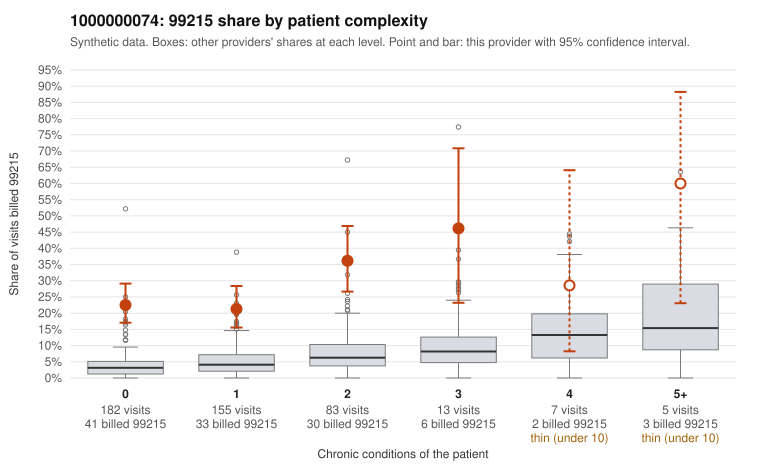

# 1000000074: 1000000074: 0 of 7 documented 99215 claims (0%) are documented below the billed level

**Leaning (advisory):** Pattern consistent with upcoding

## Why

1000000074 billed 99215 on 25.8% of 445 claims against an expected 4.2% given patient complexity (risk-adjusted score 8.98; plain z-score vs peers 2.85). 64% of this provider's 99215 claims were on patients with 0 or 1 chronic conditions. Records came back for 30 claims. Of 7 documented 99215 claims, 0 (0%) were documented below the billed level, against 31% for the comparison providers. Note checks on 30 returned notes (share showing each sign): problems 43%, late 10%, unsigned 0%, data 20%, bulk created 3%, paste heavy 13%. 7 of 20 notes claiming moderate-or-higher data reviewed had no lab or test line on the claim. This pattern is consistent with upcoding. It is a reason to review the records, not a finding. Examples: C0040526: billed 99215, patient aged 56 with 0 chronic condition(s). C0040545: billed 99215, patient aged 55 with 1 chronic condition(s) (heart failure). C0040551: billed 99215, patient aged 39 with 1 chronic condition(s) (hypertension).

## Evidence chart

## Cited claims

`C0040526`, `C0040545`, `C0040551`

## Suggested next steps

- Request the full charts for C0040526, C0040545, C0040551 and have a certified coder re-score each against the current E/M rules (medical decision making or total time).
- If the re-scoring confirms the pattern, review the random sample in the recovery packet's sampling plan before any overpayment estimate; do not extrapolate from a targeted sample.
- Look at the notes themselves: 43% address fewer problems than their level implies and 10% were signed late; request the audit trail for C0040526, C0040545, C0040551.

---
Citations checked: 3/3 valid. Synthetic data. The leaning is advisory; the flag comes from the statistical screen, and no clinical documentation is available beyond the sampled records-review facts shown in the packet.
