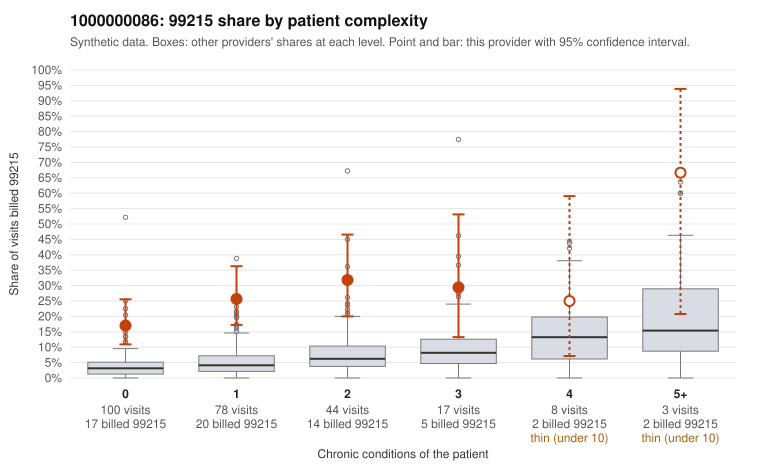

# 1000000086: 1000000086: 0 of 6 documented 99215 claims (0%) are documented below the billed level

**Leaning (advisory):** Pattern consistent with upcoding

## Why

1000000086 billed 99215 on 24.0% of 250 claims against an expected 4.5% given patient complexity (risk-adjusted score 5.89; plain z-score vs peers 2.56). 62% of this provider's 99215 claims were on patients with 0 or 1 chronic conditions. Records came back for 29 claims. Of 6 documented 99215 claims, 0 (0%) were documented below the billed level, against 31% for the comparison providers. Note checks on 29 returned notes (share showing each sign): problems 45%, late 17%, unsigned 0%, data 21%, bulk created 14%, paste heavy 24%. 6 of 21 notes claiming moderate-or-higher data reviewed had no lab or test line on the claim. This pattern is consistent with upcoding. It is a reason to review the records, not a finding. Examples: C0045685: billed 99215, patient aged 32 with 0 chronic condition(s). C0045692: billed 99215, patient aged 37 with 0 chronic condition(s). C0045707: billed 99215, patient aged 35 with 0 chronic condition(s).

## Evidence chart

## Cited claims

`C0045685`, `C0045692`, `C0045707`

## Suggested next steps

- Request the full charts for C0045685, C0045692, C0045707 and have a certified coder re-score each against the current E/M rules (medical decision making or total time).
- If the re-scoring confirms the pattern, review the random sample in the recovery packet's sampling plan before any overpayment estimate; do not extrapolate from a targeted sample.
- Look at the notes themselves: 45% address fewer problems than their level implies and 17% were signed late; request the audit trail for C0045685, C0045692, C0045707.

---
Citations checked: 3/3 valid. Synthetic data. The leaning is advisory; the flag comes from the statistical screen, and no clinical documentation is available beyond the sampled records-review facts shown in the packet.
