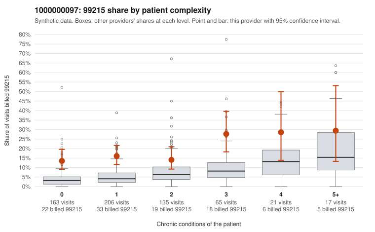

# 1000000097: 1000000097: too few returned records to judge

**Leaning (advisory):** Inconclusive

## Why

1000000097 billed 99215 on 17.0% of 607 claims against an expected 5.1% given patient complexity (risk-adjusted score 5.26; plain z-score vs peers 1.48). 53% of this provider's 99215 claims were on patients with 0 or 1 chronic conditions. Records came back for 21 claims. Of 16 documented 99215 claims, 3 (19%) were documented below the billed level, against 31% for the comparison providers. Note checks on 21 returned notes (share showing each sign): problems 43%, late 5%, unsigned 0%, data 0%, bulk created 0%, paste heavy 5%. 0 of 17 notes claiming moderate-or-higher data reviewed had no lab or test line on the claim. The evidence does not support a call either way yet. Examples: C0049280: billed 99215; documented MDM level moderate, 30 minutes. C0049330: billed 99215, patient aged 40 with 0 chronic condition(s); documented MDM level moderate, minutes not recorded. C0049084: billed 99215, patient aged 33 with 0 chronic condition(s). C0049093: billed 99215, patient aged 18 with 1 chronic condition(s) (hypertension); documented MDM level high, minutes not recorded.

## Evidence chart

## Cited claims

`C0049280`, `C0049330`, `C0049084`, `C0049093`

## Suggested next steps

- 21 charts came back but do not settle it: request a targeted sample of 99215 charts, starting with C0049280, C0049330, C0049084.
- Re-check after the targeted charts arrive; do not call upcoding or a sicker panel on this evidence alone.

---
Citations checked: 4/4 valid. Synthetic data. The leaning is advisory; the flag comes from the statistical screen, and no clinical documentation is available beyond the sampled records-review facts shown in the packet.
