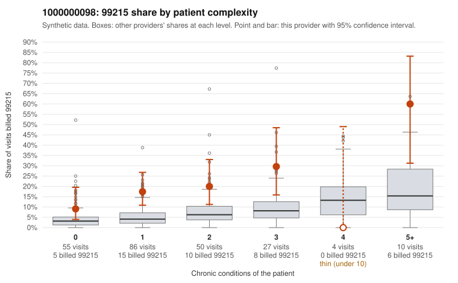

# 1000000098: 1000000098: too few returned records to judge

**Leaning (advisory):** Inconclusive

## Why

1000000098 billed 99215 on 19.0% of 232 claims against an expected 5.2% given patient complexity (risk-adjusted score 3.67; plain z-score vs peers 1.79). 45% of this provider's 99215 claims were on patients with 0 or 1 chronic conditions. Records came back for 30 claims. Of 7 documented 99215 claims, 1 (14%) were documented below the billed level, against 31% for the comparison providers. Note checks on 30 returned notes (share showing each sign): problems 30%, late 7%, unsigned 0%, data 3%. No audit trail was received. 2 of 19 notes claiming moderate-or-higher data reviewed had no lab or test line on the claim. The evidence does not support a call either way yet. Examples: C0049837: billed 99215; documented MDM level moderate, 37 minutes. C0049761: billed 99215, patient aged 41 with 0 chronic condition(s). C0049766: billed 99215, patient aged 57 with 1 chronic condition(s) (hypertension).

## Evidence chart

## Cited claims

`C0049837`, `C0049761`, `C0049766`

## Suggested next steps

- 30 charts came back but do not settle it: request a targeted sample of 99215 charts, starting with C0049837, C0049761, C0049766.
- Re-check after the targeted charts arrive; do not call upcoding or a sicker panel on this evidence alone.

---
Citations checked: 3/3 valid. Synthetic data. The leaning is advisory; the flag comes from the statistical screen, and no clinical documentation is available beyond the sampled records-review facts shown in the packet.
