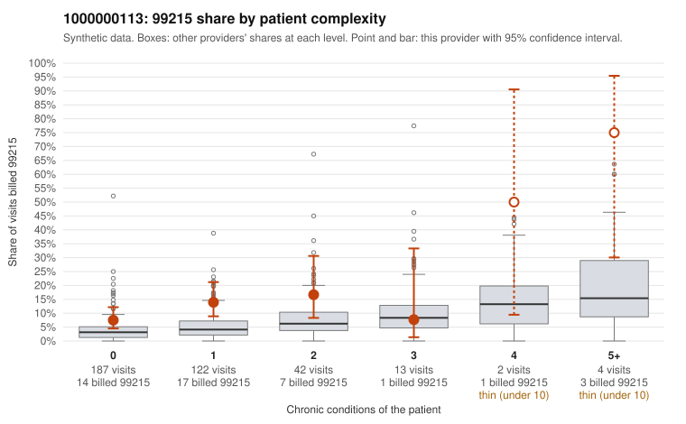

# 1000000113: 1000000113: too few returned records to judge

**Leaning (advisory):** Inconclusive

## Why

1000000113 billed 99215 on 11.6% of 370 claims against an expected 4.0% given patient complexity (risk-adjusted score 2.92; plain z-score vs peers 0.66). 72% of this provider's 99215 claims were on patients with 0 or 1 chronic conditions. Records came back for 45 claims. Of 17 documented 99215 claims, 5 (29%) were documented below the billed level, against 31% for the comparison providers. Note checks on 45 returned notes (share showing each sign): problems 53%, late 4%, unsigned 0%, data 4%, bulk created 0%, paste heavy 4%. 3 of 35 notes claiming moderate-or-higher data reviewed had no lab or test line on the claim. The evidence does not support a call either way yet. Examples: C0056262: billed 99215; documented MDM level low, minutes not recorded. C0056283: billed 99215; documented MDM level moderate, 39 minutes. C0056233: billed 99215, patient aged 39 with 1 chronic condition(s) (COPD). C0056245: billed 99215, patient aged 49 with 0 chronic condition(s).

## Evidence chart

## Cited claims

`C0056262`, `C0056283`, `C0056233`, `C0056245`

## Suggested next steps

- 45 charts came back but do not settle it: request a targeted sample of 99215 charts, starting with C0056262, C0056283, C0056233.
- Re-check after the targeted charts arrive; do not call upcoding or a sicker panel on this evidence alone.

---
Citations checked: 4/4 valid. Synthetic data. The leaning is advisory; the flag comes from the statistical screen, and no clinical documentation is available beyond the sampled records-review facts shown in the packet.
