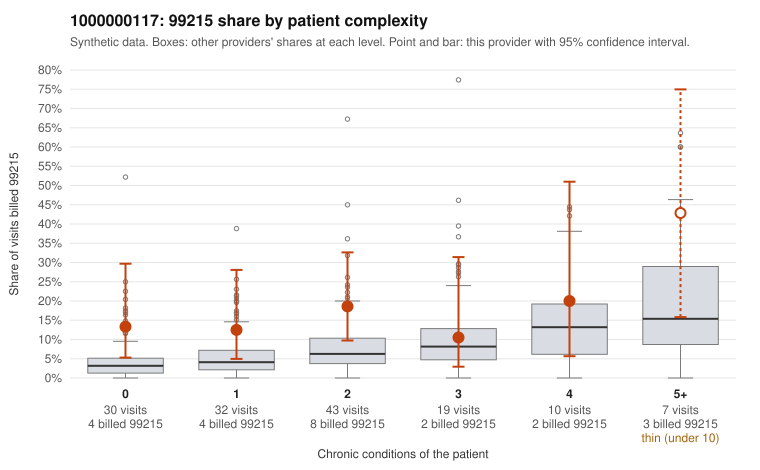

# 1000000117: 1000000117: too few returned records to judge

**Leaning (advisory):** Inconclusive

## Why

1000000117 billed 99215 on 16.3% of 141 claims against an expected 5.9% given patient complexity (risk-adjusted score 1.98; plain z-score vs peers 1.38). 35% of this provider's 99215 claims were on patients with 0 or 1 chronic conditions. Records came back for 6 claims. Of 1 documented 99215 claims, 0 (0%) were documented below the billed level, against 31% for the comparison providers. 1 of 4 notes claiming moderate-or-higher data reviewed had no lab or test line on the claim. The evidence does not support a call either way yet. Examples: C0057774: billed 99215, patient aged 36 with 0 chronic condition(s). C0057805: billed 99215, patient aged 37 with 1 chronic condition(s) (hyperlipidemia).

## Evidence chart

## Cited claims

`C0057774`, `C0057805`

## Suggested next steps

- 6 charts came back but do not settle it: request a targeted sample of 99215 charts, starting with C0057774, C0057805.
- Re-check after the targeted charts arrive; do not call upcoding or a sicker panel on this evidence alone.

---
Citations checked: 2/2 valid. Synthetic data. The leaning is advisory; the flag comes from the statistical screen, and no clinical documentation is available beyond the sampled records-review facts shown in the packet.
