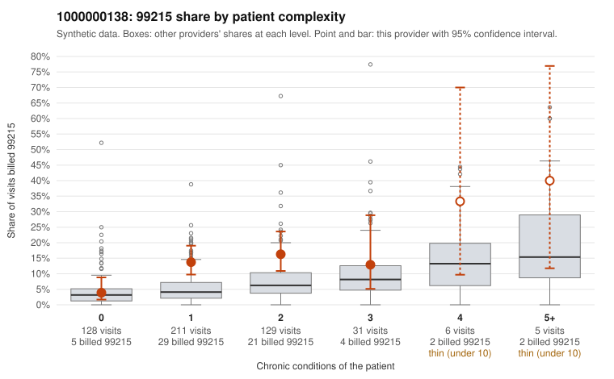

# 1000000138: 1000000138: too few returned records to judge

**Leaning (advisory):** Inconclusive

## Why

1000000138 billed 99215 on 12.4% of 510 claims against an expected 4.6% given patient complexity (risk-adjusted score 3.25; plain z-score vs peers 0.77). 54% of this provider's 99215 claims were on patients with 0 or 1 chronic conditions. Records came back for 30 claims. Of 2 documented 99215 claims, 1 (50%) were documented below the billed level, against 31% for the comparison providers. Note checks on 30 returned notes (share showing each sign): problems 33%, late 0%, unsigned 0%, data 7%. No audit trail was received. 4 of 23 notes claiming moderate-or-higher data reviewed had no lab or test line on the claim. The evidence does not support a call either way yet. Examples: C0066836: billed 99215, patient aged 46 with 1 chronic condition(s) (atrial fibrillation); documented MDM level moderate, minutes not recorded. C0066589: billed 99215, patient aged 40 with 1 chronic condition(s) (osteoarthritis). C0066593: billed 99215, patient aged 57 with 1 chronic condition(s) (obesity).

## Evidence chart

## Cited claims

`C0066836`, `C0066589`, `C0066593`

## Suggested next steps

- 30 charts came back but do not settle it: request a targeted sample of 99215 charts, starting with C0066836, C0066589, C0066593.
- Re-check after the targeted charts arrive; do not call upcoding or a sicker panel on this evidence alone.

---
Citations checked: 3/3 valid. Synthetic data. The leaning is advisory; the flag comes from the statistical screen, and no clinical documentation is available beyond the sampled records-review facts shown in the packet.
