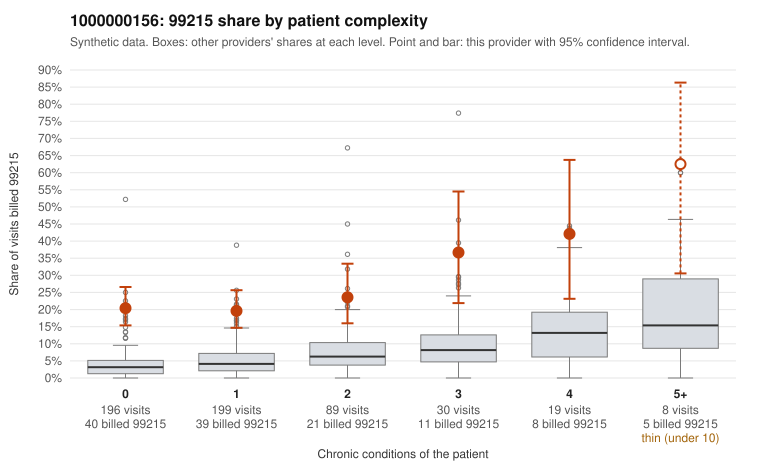

# 1000000156: 1000000156: too few returned records to judge

**Leaning (advisory):** Inconclusive

## Why

1000000156 billed 99215 on 22.9% of 541 claims against an expected 4.5% given patient complexity (risk-adjusted score 8.18; plain z-score vs peers 2.40). 64% of this provider's 99215 claims were on patients with 0 or 1 chronic conditions. Records came back for 20 claims. Of 13 documented 99215 claims, 2 (15%) were documented below the billed level, against 31% for the comparison providers. Note checks on 20 returned notes (share showing each sign): problems 40%, late 0%, unsigned 0%, data 5%. No audit trail was received. 2 of 17 notes claiming moderate-or-higher data reviewed had no lab or test line on the claim. The evidence does not support a call either way yet. Examples: C0074396: billed 99215; documented MDM level moderate, minutes not recorded. C0074509: billed 99215; documented MDM level moderate, minutes not recorded. C0074192: billed 99215, patient aged 57 with 1 chronic condition(s) (hyperlipidemia). C0074237: billed 99215, patient aged 57 with 0 chronic condition(s).

## Evidence chart

## Cited claims

`C0074396`, `C0074509`, `C0074192`, `C0074237`

## Suggested next steps

- 20 charts came back but do not settle it: request a targeted sample of 99215 charts, starting with C0074396, C0074509, C0074192.
- Re-check after the targeted charts arrive; do not call upcoding or a sicker panel on this evidence alone.

---
Citations checked: 4/4 valid. Synthetic data. The leaning is advisory; the flag comes from the statistical screen, and no clinical documentation is available beyond the sampled records-review facts shown in the packet.
