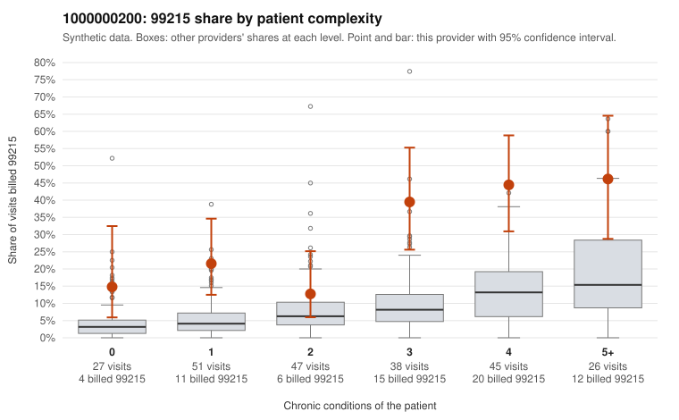

# Payment Integrity dossier: 1000000200

> Draft for human review. Statistical and records-sample evidence only; not a finding. Compliance or legal review is needed before any provider contact, notice or recoupment.

## Provider overview

| | |
|---|---|
| Specialty / state | Family Practice, GA (synthetic) |
| Claims / patients | 234 / 124 |
| Billed mix (99211 to 99215) | 0 / 1 / 41 / 124 / 68 |
| 99215 share | 29.1% |
| Expected 99215 share given patient complexity | 7.7% |
| Screen scores | z vs peers 3.34; risk-adjusted 4.86; flagged by eb_ratio_t |

## Case summary (advisory)

**1000000200: 14 of 23 documented 99215 claims (61%) are documented below the billed level**

Leaning: pattern consistent with upcoding. Citations checked: 6/6 valid.

1000000200 billed 99215 on 29.1% of 234 claims against an expected 7.7% given patient complexity (risk-adjusted score 4.86; plain z-score vs peers 3.34). 22% of this provider's 99215 claims were on patients with 0 or 1 chronic conditions. Records came back for 45 claims. Of 23 documented 99215 claims, 14 (61%) were documented below the billed level, against 31% for the comparison providers. Note checks on 45 returned notes (share showing each sign): problems 13%, late 7%, unsigned 0%, data 2%. No audit trail was received. 1 of 31 notes claiming moderate-or-higher data reviewed had no lab or test line on the claim. This pattern is consistent with upcoding. It is a reason to review the records, not a finding. Examples: C0102222: billed 99215; documented MDM level moderate, 21 minutes. C0102225: billed 99215; documented MDM level moderate, 39 minutes. C0102436: billed 99215; documented MDM level moderate, 35 minutes. C0102236: billed 99215, patient aged 42 with 1 chronic condition(s) (osteoarthritis). C0102238: billed 99215, patient aged 37 with 1 chronic condition(s) (hypertension). C0102248: billed 99215, patient aged 48 with 1 chronic condition(s) (hyperlipidemia).

## Evidence chart

## Records-review sample so far

Documentation is on file for 45 claims (19% of this provider's claims).

| Billed | Documented | Documentation below billed level | Rate | All-provider rate |
|---|---|---|---|---|
| 99213 | 5 | 0 | 0.0% | 4.8% |
| 99214 | 17 | 4 | 23.5% | 4.6% |
| 99215 | 23 | 14 | 60.9% | 31.2% |

## Recommended next steps for Payment Integrity

1. Request records for the sampled claims in `record_request_list.csv` (35 claims across 99215).
2. Review the records against E/M documentation rules and record the supported level for each claim.
3. Run the overpayment estimator on the reviewed sample (`sampling_plan.md` explains how).
4. Notice, appeal rights, recoupment, education or corrective action, and any referral are decisions for the PI team, compliance and counsel. Nothing here drafts those.

Suggested follow-ups from the case summary:

- Request the full charts for C0102222, C0102225, C0102436 and have a certified coder re-score each against the current E/M rules (medical decision making or total time).
- If the re-scoring confirms the pattern, review the random sample in the recovery packet's sampling plan before any overpayment estimate; do not extrapolate from a targeted sample.
- Look at the notes themselves: 13% address fewer problems than their level implies and 7% were signed late; request the audit trail for C0102222, C0102225, C0102436.

## Limits

- Synthetic data; no real claims or providers.
- The leaning is advisory. The flag comes from the statistical screen; the summary explains it.
- The records-review sample is partial and was simulated for this project.
- Allowed amounts are GA Family Practice averages from a public CMS file, not this provider's actual payments.
