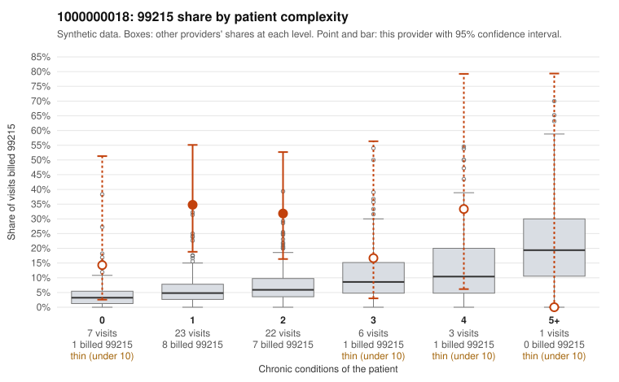

# 1000000018: 1000000018: too few returned records to judge

**Leaning (advisory):** Inconclusive

## Why

1000000018 billed 99215 on 29.0% of 62 claims against an expected 5.6% given patient complexity (risk-adjusted score 2.96; plain z-score vs peers 3.33). 50% of this provider's 99215 claims were on patients with 0 or 1 chronic conditions. Records came back for 30 claims. Of 5 documented 99215 claims, 1 (20%) were documented below the billed level, against 24% for the comparison providers. Note checks on 30 returned notes (share showing each sign): problems 17%, late 0%, unsigned 0%, data 13%, bulk created 0%, paste heavy 0%. 5 of 26 notes claiming moderate-or-higher data reviewed had no lab or test line on the claim. The evidence does not support a call either way yet. Examples: C0006486: billed 99215; documented MDM level moderate, 26 minutes. C0006484: billed 99215, patient aged 61 with 1 chronic condition(s) (hyperlipidemia). C0006487: billed 99215, patient aged 46 with 1 chronic condition(s) (osteoarthritis).

## Evidence chart

## Cited claims

`C0006486`, `C0006484`, `C0006487`

## Suggested next steps

- 30 charts came back but do not settle it: request a targeted sample of 99215 charts, starting with C0006486, C0006484, C0006487.
- Re-check after the targeted charts arrive; do not call upcoding or a sicker panel on this evidence alone.

---
Citations checked: 3/3 valid. Synthetic data. The leaning is advisory; the flag comes from the statistical screen, and no clinical documentation is available beyond the sampled records-review facts shown in the packet.
