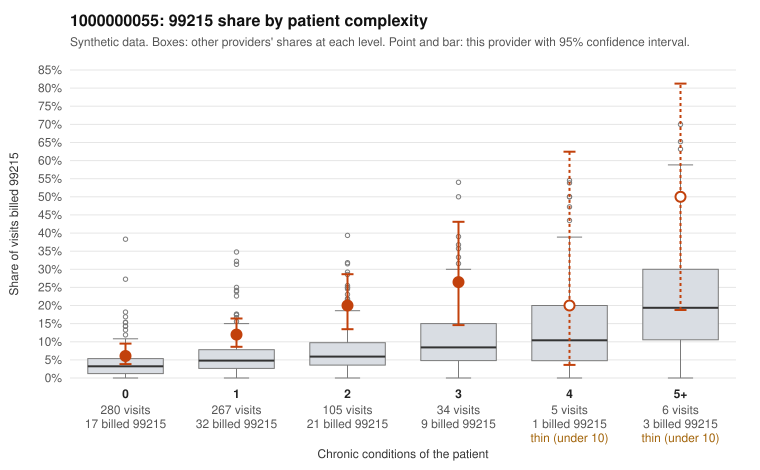

# 1000000055: 1000000055: too few returned records to judge

**Leaning (advisory):** Inconclusive

## Why

1000000055 billed 99215 on 11.9% of 697 claims against an expected 4.3% given patient complexity (risk-adjusted score 3.65; plain z-score vs peers 0.68). 59% of this provider's 99215 claims were on patients with 0 or 1 chronic conditions. Records came back for 30 claims. Of 4 documented 99215 claims, 0 (0%) were documented below the billed level, against 24% for the comparison providers. Note checks on 30 returned notes (share showing each sign): problems 50%, late 10%, unsigned 0%, data 7%. No audit trail was received. 3 of 23 notes claiming moderate-or-higher data reviewed had no lab or test line on the claim. The evidence does not support a call either way yet. Examples: C0031331: billed 99214; documented MDM level low, minutes not recorded. C0030898: billed 99215, patient aged 40 with 1 chronic condition(s) (heart failure). C0030906: billed 99215, patient aged 59 with 1 chronic condition(s) (hyperlipidemia).

## Evidence chart

## Cited claims

`C0031331`, `C0030898`, `C0030906`

## Suggested next steps

- 30 charts came back but do not settle it: request a targeted sample of 99215 charts, starting with C0031331, C0030898, C0030906.
- Re-check after the targeted charts arrive; do not call upcoding or a sicker panel on this evidence alone.

---
Citations checked: 3/3 valid. Synthetic data. The leaning is advisory; the flag comes from the statistical screen, and no clinical documentation is available beyond the sampled records-review facts shown in the packet.
