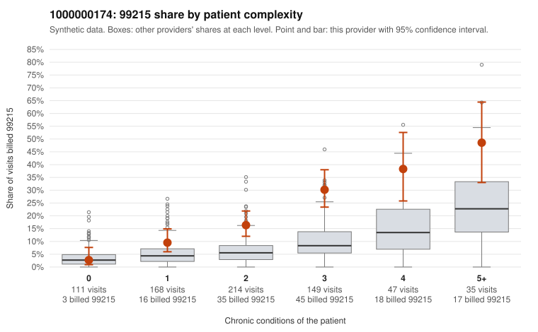

# 1000000174: 1000000174: too few returned records to judge

**Leaning (advisory):** Inconclusive

## Why

1000000174 billed 99215 on 18.5% of 724 claims against an expected 6.4% given patient complexity (risk-adjusted score 4.74; plain z-score vs peers 1.63). 14% of this provider's 99215 claims were on patients with 0 or 1 chronic conditions. Records came back for 14 claims. Of 4 documented 99215 claims, 0 (0%) were documented below the billed level, against 27% for the comparison providers. Note checks on 14 returned notes (share showing each sign): problems 14%, late 7%, unsigned 0%, data 7%. No audit trail was received. 3 of 12 notes claiming moderate-or-higher data reviewed had no lab or test line on the claim. The evidence does not support a call either way yet. Examples: C0095506: billed 99213; documented MDM level straightforward, minutes not recorded. C0094917: billed 99215, patient aged 34 with 1 chronic condition(s) (type 2 diabetes); documented MDM level high, minutes not recorded. C0095032: billed 99215, patient aged 48 with 1 chronic condition(s) (hypertension).

## Evidence chart

## Cited claims

`C0095506`, `C0094917`, `C0095032`

## Suggested next steps

- 14 charts came back but do not settle it: request a targeted sample of 99215 charts, starting with C0095506, C0094917, C0095032.
- Re-check after the targeted charts arrive; do not call upcoding or a sicker panel on this evidence alone.

---
Citations checked: 3/3 valid. Synthetic data. The leaning is advisory; the flag comes from the statistical screen, and no clinical documentation is available beyond the sampled records-review facts shown in the packet.
