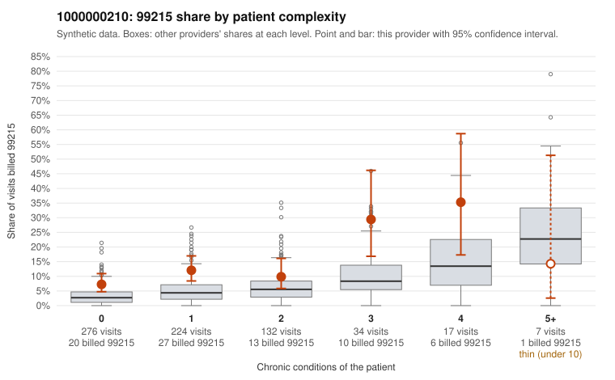

# 1000000210: 1000000210: too few returned records to judge

**Leaning (advisory):** Inconclusive

## Why

1000000210 billed 99215 on 11.2% of 690 claims against an expected 4.4% given patient complexity (risk-adjusted score 2.99; plain z-score vs peers 0.54). 61% of this provider's 99215 claims were on patients with 0 or 1 chronic conditions. Records came back for 29 claims. Of 2 documented 99215 claims, 0 (0%) were documented below the billed level, against 27% for the comparison providers. Note checks on 29 returned notes (share showing each sign): problems 48%, late 7%, unsigned 0%, data 3%. No audit trail was received. 1 of 19 notes claiming moderate-or-higher data reviewed had no lab or test line on the claim. The evidence does not support a call either way yet. Examples: C0118172: billed 99215, patient aged 50 with 0 chronic condition(s). C0118189: billed 99215, patient aged 33 with 0 chronic condition(s).

## Evidence chart

## Cited claims

`C0118172`, `C0118189`

## Suggested next steps

- 29 charts came back but do not settle it: request a targeted sample of 99215 charts, starting with C0118172, C0118189.
- Re-check after the targeted charts arrive; do not call upcoding or a sicker panel on this evidence alone.

---
Citations checked: 2/2 valid. Synthetic data. The leaning is advisory; the flag comes from the statistical screen, and no clinical documentation is available beyond the sampled records-review facts shown in the packet.
