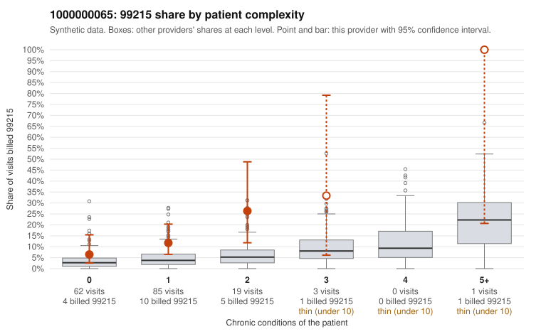

# 1000000065: 1000000065: too few returned records to judge

**Leaning (advisory):** Inconclusive

## Why

1000000065 billed 99215 on 12.4% of 170 claims against an expected 3.6% given patient complexity (risk-adjusted score 2.66; plain z-score vs peers 1.00). 67% of this provider's 99215 claims were on patients with 0 or 1 chronic conditions. Records came back for 30 claims. Of 7 documented 99215 claims, 1 (14%) were documented below the billed level, against 42% for the comparison providers. Note checks on 30 returned notes (share showing each sign): problems 47%, late 10%, unsigned 0%, data 0%. No audit trail was received. 1 of 22 notes claiming moderate-or-higher data reviewed had no lab or test line on the claim. The evidence does not support a call either way yet. Examples: C0031559: billed 99215, patient aged 74 with 1 chronic condition(s) (type 2 diabetes); documented MDM level moderate, 30 minutes. C0031433: billed 99215, patient aged 57 with 1 chronic condition(s) (hyperlipidemia). C0031444: billed 99215, patient aged 65 with 0 chronic condition(s).

## Evidence chart

## Cited claims

`C0031559`, `C0031433`, `C0031444`

## Suggested next steps

- 30 charts came back but do not settle it: request a targeted sample of 99215 charts, starting with C0031559, C0031433, C0031444.
- Re-check after the targeted charts arrive; do not call upcoding or a sicker panel on this evidence alone.

---
Citations checked: 3/3 valid. Synthetic data. The leaning is advisory; the flag comes from the statistical screen, and no clinical documentation is available beyond the sampled records-review facts shown in the packet.
