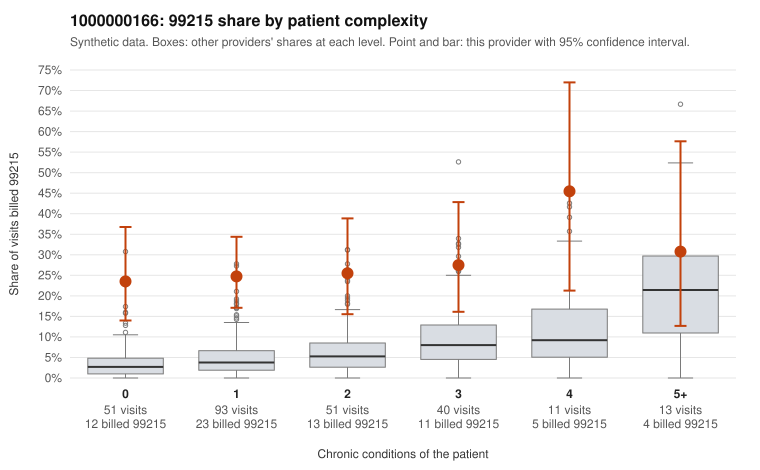

# 1000000166: 1000000166: 16 of 22 documented 99215 claims (73%) are documented below the billed level

**Leaning (advisory):** Pattern consistent with upcoding

## Why

1000000166 billed 99215 on 26.3% of 259 claims against an expected 5.5% given patient complexity (risk-adjusted score 6.47; plain z-score vs peers 3.48). 51% of this provider's 99215 claims were on patients with 0 or 1 chronic conditions. Records came back for 45 claims. Of 22 documented 99215 claims, 16 (73%) were documented below the billed level, against 42% for the comparison providers. Note checks on 45 returned notes (share showing each sign): problems 31%, late 0%, unsigned 0%, data 7%. No audit trail was received. 4 of 29 notes claiming moderate-or-higher data reviewed had no lab or test line on the claim. This pattern is consistent with upcoding. It is a reason to review the records, not a finding. Examples: C0078295: billed 99215, patient aged 55 with 0 chronic condition(s); documented MDM level moderate, minutes not recorded. C0078363: billed 99215; documented MDM level moderate, 39 minutes. C0078372: billed 99215, patient aged 77 with 4 chronic condition(s) (type 2 diabetes;obesity;hypertension;atrial fibrillation); documented MDM level moderate, minutes not recorded. C0078229: billed 99215, patient aged 67 with 1 chronic condition(s) (asthma). C0078253: billed 99215, patient aged 18 with 0 chronic condition(s). C0078257: billed 99215, patient aged 38 with 0 chronic condition(s).

## Evidence chart

## Cited claims

`C0078295`, `C0078363`, `C0078372`, `C0078229`, `C0078253`, `C0078257`

## Suggested next steps

- Request the full charts for C0078295, C0078363, C0078372 and have a certified coder re-score each against the current E/M rules (medical decision making or total time).
- If the re-scoring confirms the pattern, review the random sample in the recovery packet's sampling plan before any overpayment estimate; do not extrapolate from a targeted sample.
- Look at the notes themselves: 31% address fewer problems than their level implies and 0% were signed late; request the audit trail for C0078295, C0078363, C0078372.

---
Citations checked: 6/6 valid. Synthetic data. The leaning is advisory; the flag comes from the statistical screen, and no clinical documentation is available beyond the sampled records-review facts shown in the packet.
