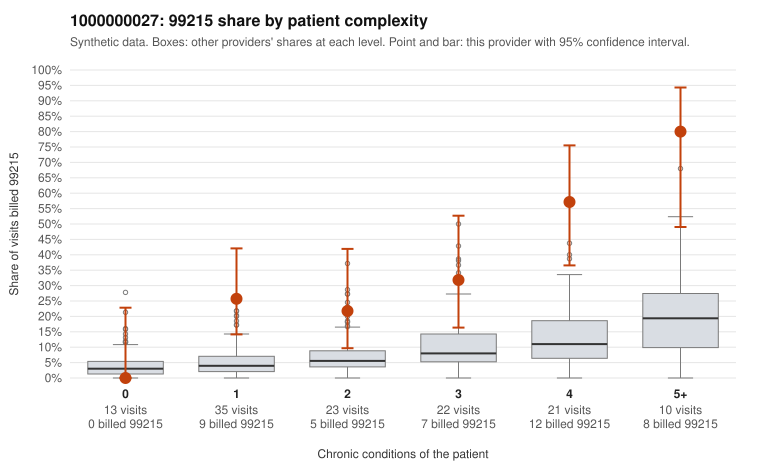

# 1000000027: 1000000027: too few returned records to judge

**Leaning (advisory):** Inconclusive

## Why

1000000027 billed 99215 on 33.1% of 124 claims against an expected 6.7% given patient complexity (risk-adjusted score 4.84; plain z-score vs peers 4.98). 22% of this provider's 99215 claims were on patients with 0 or 1 chronic conditions. Records came back for 45 claims. Of 21 documented 99215 claims, 1 (5%) were documented below the billed level, against 42% for the comparison providers. Note checks on 45 returned notes (share showing each sign): problems 11%, late 9%, unsigned 0%, data 2%. No audit trail was received. 1 of 39 notes claiming moderate-or-higher data reviewed had no lab or test line on the claim. The evidence does not support a call either way yet. Examples: C0007860: billed 99215; documented MDM level moderate, 33 minutes. C0007796: billed 99215, patient aged 55 with 1 chronic condition(s) (hypertension). C0007809: billed 99215, patient aged 65 with 1 chronic condition(s) (obesity).

## Evidence chart

## Cited claims

`C0007860`, `C0007796`, `C0007809`

## Suggested next steps

- 45 charts came back but do not settle it: request a targeted sample of 99215 charts, starting with C0007860, C0007796, C0007809.
- Re-check after the targeted charts arrive; do not call upcoding or a sicker panel on this evidence alone.

---
Citations checked: 3/3 valid. Synthetic data. The leaning is advisory; the flag comes from the statistical screen, and no clinical documentation is available beyond the sampled records-review facts shown in the packet.
