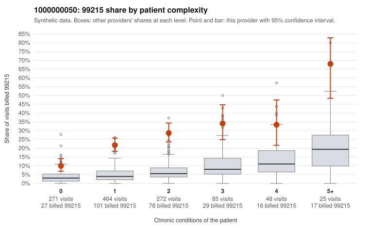

# 1000000050: 1000000050: too few returned records to judge

**Leaning (advisory):** Inconclusive

## Why

1000000050 billed 99215 on 23.0% of 1,165 claims against an expected 4.8% given patient complexity (risk-adjusted score 12.17; plain z-score vs peers 3.09). 48% of this provider's 99215 claims were on patients with 0 or 1 chronic conditions. Records came back for 45 claims. Of 24 documented 99215 claims, 5 (21%) were documented below the billed level, against 42% for the comparison providers. Note checks on 45 returned notes (share showing each sign): problems 29%, late 2%, unsigned 0%, data 4%. No audit trail was received. 2 of 35 notes claiming moderate-or-higher data reviewed had no lab or test line on the claim. The evidence does not support a call either way yet. Examples: C0019901: billed 99215; documented MDM level moderate, minutes not recorded. C0019941: billed 99215, patient aged 39 with 0 chronic condition(s); documented MDM level moderate, 34 minutes. C0019933: billed 99215, patient aged 58 with 1 chronic condition(s) (COPD).

## Evidence chart

## Cited claims

`C0019901`, `C0019941`, `C0019933`

## Suggested next steps

- 45 charts came back but do not settle it: request a targeted sample of 99215 charts, starting with C0019901, C0019941, C0019933.
- Re-check after the targeted charts arrive; do not call upcoding or a sicker panel on this evidence alone.

---
Citations checked: 3/3 valid. Synthetic data. The leaning is advisory; the flag comes from the statistical screen, and no clinical documentation is available beyond the sampled records-review facts shown in the packet.
