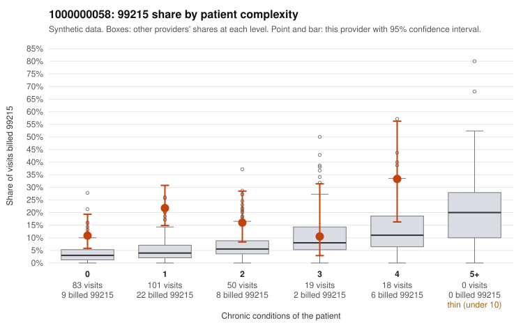

# 1000000058: 1000000058: too few returned records to judge

**Leaning (advisory):** Inconclusive

## Why

1000000058 billed 99215 on 17.3% of 271 claims against an expected 4.5% given patient complexity (risk-adjusted score 4.18; plain z-score vs peers 2.02). 66% of this provider's 99215 claims were on patients with 0 or 1 chronic conditions. Records came back for 29 claims. Of 5 documented 99215 claims, 0 (0%) were documented below the billed level, against 42% for the comparison providers. Note checks on 29 returned notes (share showing each sign): problems 62%, late 7%, unsigned 0%, data 3%. No audit trail was received. 1 of 21 notes claiming moderate-or-higher data reviewed had no lab or test line on the claim. The evidence does not support a call either way yet. Examples: C0024756: billed 99214; documented MDM level low, minutes not recorded. C0024903: billed 99214; documented MDM level low, 17 minutes. C0024666: billed 99215, patient aged 36 with 0 chronic condition(s). C0024672: billed 99215, patient aged 45 with 0 chronic condition(s).

## Evidence chart

## Cited claims

`C0024756`, `C0024903`, `C0024666`, `C0024672`

## Suggested next steps

- 29 charts came back but do not settle it: request a targeted sample of 99215 charts, starting with C0024756, C0024903, C0024666.
- Re-check after the targeted charts arrive; do not call upcoding or a sicker panel on this evidence alone.

---
Citations checked: 4/4 valid. Synthetic data. The leaning is advisory; the flag comes from the statistical screen, and no clinical documentation is available beyond the sampled records-review facts shown in the packet.
