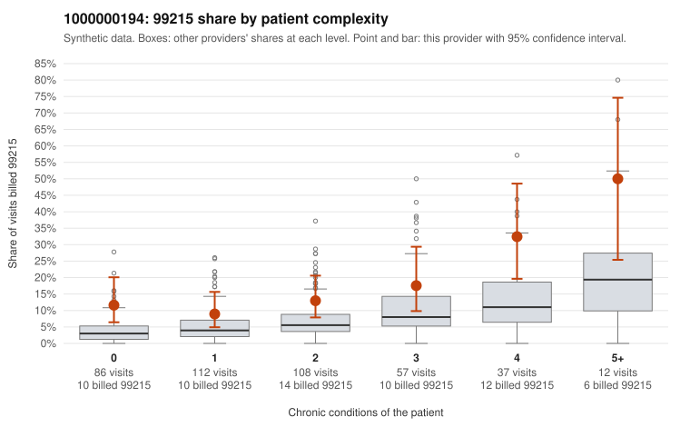

# 1000000194: 1000000194: too few returned records to judge

**Leaning (advisory):** Inconclusive

## Why

1000000194 billed 99215 on 15.0% of 412 claims against an expected 5.5% given patient complexity (risk-adjusted score 3.48; plain z-score vs peers 1.59). 32% of this provider's 99215 claims were on patients with 0 or 1 chronic conditions. Records came back for 30 claims. Of 3 documented 99215 claims, 1 (33%) were documented below the billed level, against 42% for the comparison providers. Note checks on 30 returned notes (share showing each sign): problems 37%, late 3%, unsigned 0%, data 10%, bulk created 0%, paste heavy 3%. 3 of 18 notes claiming moderate-or-higher data reviewed had no lab or test line on the claim. The evidence does not support a call either way yet. Examples: C0095098: billed 99215; documented MDM level moderate, 37 minutes. C0095048: billed 99215, patient aged 36 with 1 chronic condition(s) (type 2 diabetes). C0095054: billed 99215, patient aged 96 with 1 chronic condition(s) (depression).

## Evidence chart

## Cited claims

`C0095098`, `C0095048`, `C0095054`

## Suggested next steps

- 30 charts came back but do not settle it: request a targeted sample of 99215 charts, starting with C0095098, C0095048, C0095054.
- Re-check after the targeted charts arrive; do not call upcoding or a sicker panel on this evidence alone.

---
Citations checked: 3/3 valid. Synthetic data. The leaning is advisory; the flag comes from the statistical screen, and no clinical documentation is available beyond the sampled records-review facts shown in the packet.
