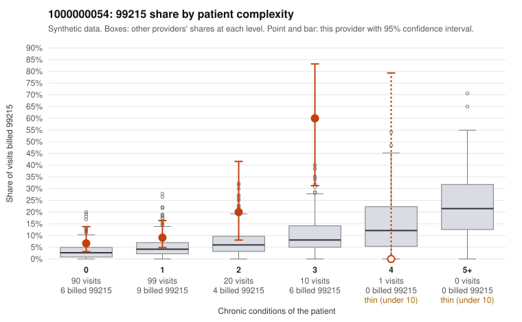

# 1000000054: 1000000054: too few returned records to judge

**Leaning (advisory):** Inconclusive

## Why

1000000054 billed 99215 on 11.4% of 220 claims against an expected 3.8% given patient complexity (risk-adjusted score 1.93; plain z-score vs peers 0.72). 60% of this provider's 99215 claims were on patients with 0 or 1 chronic conditions. Records came back for 30 claims. Of 6 documented 99215 claims, 2 (33%) were documented below the billed level, against 40% for the comparison providers. Note checks on 30 returned notes (share showing each sign): problems 37%, late 7%, unsigned 0%, data 0%. No audit trail was received. 1 of 22 notes claiming moderate-or-higher data reviewed had no lab or test line on the claim. The evidence does not support a call either way yet. Examples: C0029186: billed 99215; documented MDM level moderate, 34 minutes. C0029253: billed 99215, patient aged 41 with 1 chronic condition(s) (hyperlipidemia); documented MDM level moderate, minutes not recorded. C0029085: billed 99215, patient aged 61 with 1 chronic condition(s) (hyperlipidemia). C0029134: billed 99215, patient aged 31 with 0 chronic condition(s).

## Evidence chart

## Cited claims

`C0029186`, `C0029253`, `C0029085`, `C0029134`

## Suggested next steps

- 30 charts came back but do not settle it: request a targeted sample of 99215 charts, starting with C0029186, C0029253, C0029085.
- Re-check after the targeted charts arrive; do not call upcoding or a sicker panel on this evidence alone.

---
Citations checked: 4/4 valid. Synthetic data. The leaning is advisory; the flag comes from the statistical screen, and no clinical documentation is available beyond the sampled records-review facts shown in the packet.
