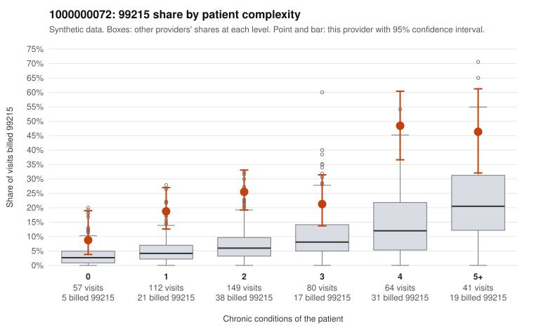

# 1000000072: 1000000072: 0 of 22 documented 99214 and 99215 claims (0%) are documented below the billed level

**Leaning (advisory):** Pattern consistent with upcoding

## Why

1000000072 billed 99215 on 26.0% of 503 claims against an expected 6.8% given patient complexity (risk-adjusted score 6.12; plain z-score vs peers 3.30). 20% of this provider's 99215 claims were on patients with 0 or 1 chronic conditions. Records came back for 30 claims. Of 4 documented 99215 claims, 0 (0%) were documented below the billed level, against 40% for the comparison providers. Note checks on 30 returned notes (share showing each sign): problems 27%, late 17%, unsigned 0%, data 20%, bulk created 10%, paste heavy 10%. 6 of 21 notes claiming moderate-or-higher data reviewed had no lab or test line on the claim. This pattern is consistent with upcoding. It is a reason to review the records, not a finding. Examples: C0038599: billed 99215, patient aged 57 with 1 chronic condition(s) (atrial fibrillation). C0038650: billed 99215, patient aged 64 with 1 chronic condition(s) (hyperlipidemia). C0038688: billed 99215, patient aged 70 with 1 chronic condition(s) (hypertension).

## Evidence chart

## Cited claims

`C0038599`, `C0038650`, `C0038688`

## Suggested next steps

- Request the full charts for C0038599, C0038650, C0038688 and have a certified coder re-score each against the current E/M rules (medical decision making or total time).
- If the re-scoring confirms the pattern, review the random sample in the recovery packet's sampling plan before any overpayment estimate; do not extrapolate from a targeted sample.
- Look at the notes themselves: 27% address fewer problems than their level implies and 17% were signed late; request the audit trail for C0038599, C0038650, C0038688.

---
Citations checked: 3/3 valid. Synthetic data. The leaning is advisory; the flag comes from the statistical screen, and no clinical documentation is available beyond the sampled records-review facts shown in the packet.
