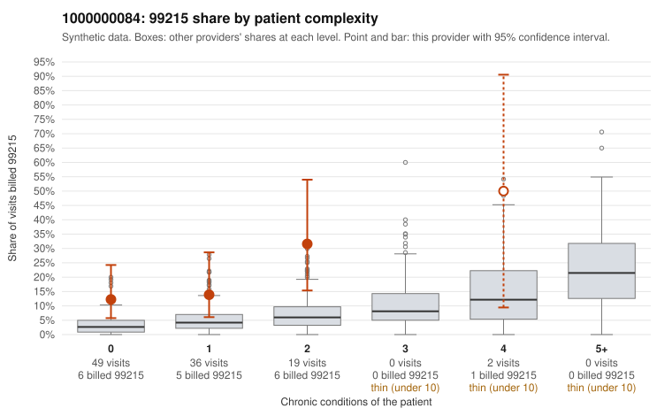

# 1000000084: 1000000084: too few returned records to judge

**Leaning (advisory):** Inconclusive

## Why

1000000084 billed 99215 on 17.0% of 106 claims against an expected 3.9% given patient complexity (risk-adjusted score 2.36; plain z-score vs peers 1.71). 61% of this provider's 99215 claims were on patients with 0 or 1 chronic conditions. Records came back for 26 claims. Of 2 documented 99215 claims, 1 (50%) were documented below the billed level, against 40% for the comparison providers. Note checks on 26 returned notes (share showing each sign): problems 54%, late 0%, unsigned 0%, data 0%. No audit trail was received. 2 of 19 notes claiming moderate-or-higher data reviewed had no lab or test line on the claim. The evidence does not support a call either way yet. Examples: C0048754: billed 99215, patient aged 46 with 1 chronic condition(s) (COPD); documented MDM level moderate, 39 minutes. C0048660: billed 99215, patient aged 60 with 1 chronic condition(s) (depression). C0048664: billed 99215, patient aged 54 with 0 chronic condition(s).

## Evidence chart

## Cited claims

`C0048754`, `C0048660`, `C0048664`

## Suggested next steps

- 26 charts came back but do not settle it: request a targeted sample of 99215 charts, starting with C0048754, C0048660, C0048664.
- Re-check after the targeted charts arrive; do not call upcoding or a sicker panel on this evidence alone.

---
Citations checked: 3/3 valid. Synthetic data. The leaning is advisory; the flag comes from the statistical screen, and no clinical documentation is available beyond the sampled records-review facts shown in the packet.
