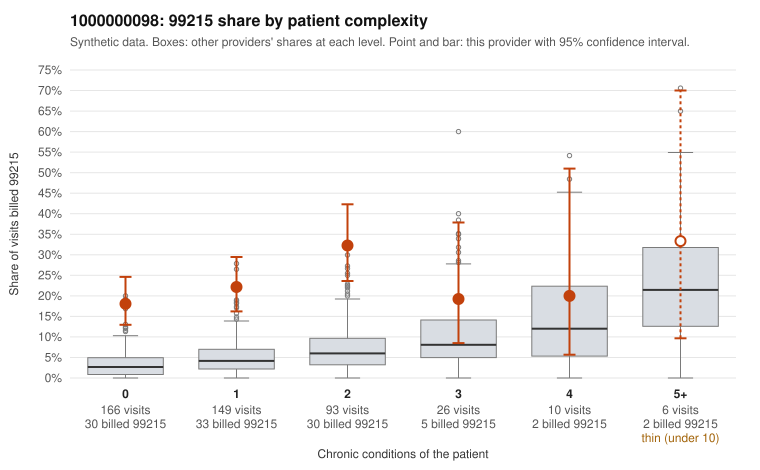

# 1000000098: 1000000098: 0 of 24 documented 99214 and 99215 claims (0%) are documented below the billed level

**Leaning (advisory):** Pattern consistent with upcoding

## Why

1000000098 billed 99215 on 22.7% of 450 claims against an expected 4.4% given patient complexity (risk-adjusted score 6.70; plain z-score vs peers 2.71). 62% of this provider's 99215 claims were on patients with 0 or 1 chronic conditions. Records came back for 30 claims. Of 4 documented 99215 claims, 0 (0%) were documented below the billed level, against 40% for the comparison providers. Note checks on 30 returned notes (share showing each sign): problems 40%, late 20%, unsigned 0%, data 23%, bulk created 10%, paste heavy 17%. 9 of 23 notes claiming moderate-or-higher data reviewed had no lab or test line on the claim. This pattern is consistent with upcoding. It is a reason to review the records, not a finding. Examples: C0052033: billed 99215, patient aged 56 with 1 chronic condition(s) (osteoarthritis). C0052048: billed 99215, patient aged 72 with 0 chronic condition(s). C0052068: billed 99215, patient aged 67 with 1 chronic condition(s) (hypertension).

## Evidence chart

## Cited claims

`C0052033`, `C0052048`, `C0052068`

## Suggested next steps

- Request the full charts for C0052033, C0052048, C0052068 and have a certified coder re-score each against the current E/M rules (medical decision making or total time).
- If the re-scoring confirms the pattern, review the random sample in the recovery packet's sampling plan before any overpayment estimate; do not extrapolate from a targeted sample.
- Look at the notes themselves: 40% address fewer problems than their level implies and 20% were signed late; request the audit trail for C0052033, C0052048, C0052068.

---
Citations checked: 3/3 valid. Synthetic data. The leaning is advisory; the flag comes from the statistical screen, and no clinical documentation is available beyond the sampled records-review facts shown in the packet.
