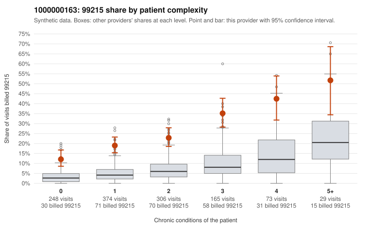

# 1000000163: 1000000163: too few returned records to judge

**Leaning (advisory):** Inconclusive

## Why

1000000163 billed 99215 on 23.0% of 1,195 claims against an expected 5.4% given patient complexity (risk-adjusted score 9.72; plain z-score vs peers 2.77). 37% of this provider's 99215 claims were on patients with 0 or 1 chronic conditions. Records came back for 45 claims. Of 23 documented 99215 claims, 3 (13%) were documented below the billed level, against 40% for the comparison providers. Note checks on 45 returned notes (share showing each sign): problems 24%, late 11%, unsigned 0%, data 4%, bulk created 0%, paste heavy 0%. 4 of 37 notes claiming moderate-or-higher data reviewed had no lab or test line on the claim. The evidence does not support a call either way yet. Examples: C0083677: billed 99215; documented MDM level moderate, minutes not recorded. C0084077: billed 99215; documented MDM level low, minutes not recorded. C0083616: billed 99215, patient aged 38 with 0 chronic condition(s). C0083656: billed 99215, patient aged 52 with 0 chronic condition(s).

## Evidence chart

## Cited claims

`C0083677`, `C0084077`, `C0083616`, `C0083656`

## Suggested next steps

- 45 charts came back but do not settle it: request a targeted sample of 99215 charts, starting with C0083677, C0084077, C0083616.
- Re-check after the targeted charts arrive; do not call upcoding or a sicker panel on this evidence alone.

---
Citations checked: 4/4 valid. Synthetic data. The leaning is advisory; the flag comes from the statistical screen, and no clinical documentation is available beyond the sampled records-review facts shown in the packet.
