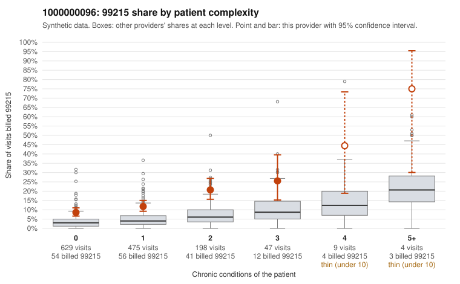

# 1000000096: 1000000096: too few returned records to judge

**Leaning (advisory):** Inconclusive

## Why

1000000096 billed 99215 on 12.5% of 1,362 claims against an expected 3.8% given patient complexity (risk-adjusted score 6.40; plain z-score vs peers 0.81). 65% of this provider's 99215 claims were on patients with 0 or 1 chronic conditions. Records came back for 45 claims. Of 17 documented 99215 claims, 7 (41%) were documented below the billed level, against 21% for the comparison providers. Note checks on 45 returned notes (share showing each sign): problems 49%, late 2%, unsigned 0%, data 7%. No audit trail was received. 5 of 33 notes claiming moderate-or-higher data reviewed had no lab or test line on the claim. The evidence does not support a call either way yet. Examples: C0049152: billed 99215; documented MDM level moderate, 31 minutes. C0049174: billed 99215; documented MDM level moderate, 39 minutes. C0048767: billed 99215, patient aged 49 with 0 chronic condition(s). C0048822: billed 99215, patient aged 56 with 0 chronic condition(s).

## Evidence chart

## Cited claims

`C0049152`, `C0049174`, `C0048767`, `C0048822`

## Suggested next steps

- 45 charts came back but do not settle it: request a targeted sample of 99215 charts, starting with C0049152, C0049174, C0048767.
- Re-check after the targeted charts arrive; do not call upcoding or a sicker panel on this evidence alone.

---
Citations checked: 4/4 valid. Synthetic data. The leaning is advisory; the flag comes from the statistical screen, and no clinical documentation is available beyond the sampled records-review facts shown in the packet.
