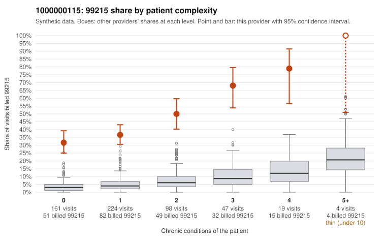

# 1000000115: 1000000115: too few returned records to judge

**Leaning (advisory):** Inconclusive

## Why

1000000115 billed 99215 on 42.1% of 553 claims against an expected 4.5% given patient complexity (risk-adjusted score 16.60; plain z-score vs peers 5.52). 57% of this provider's 99215 claims were on patients with 0 or 1 chronic conditions. Records came back for 45 claims. Of 23 documented 99215 claims, 0 (0%) were documented below the billed level, against 21% for the comparison providers. Note checks on 45 returned notes (share showing each sign): problems 38%, late 9%, unsigned 0%, data 2%, bulk created 0%, paste heavy 0%. 4 of 31 notes claiming moderate-or-higher data reviewed had no lab or test line on the claim. The evidence does not support a call either way yet. Examples: C0058838: billed 99213; documented MDM level straightforward, minutes not recorded. C0058404: billed 99215, patient aged 29 with 0 chronic condition(s). C0058444: billed 99215, patient aged 48 with 0 chronic condition(s).

## Evidence chart

## Cited claims

`C0058838`, `C0058404`, `C0058444`

## Suggested next steps

- 45 charts came back but do not settle it: request a targeted sample of 99215 charts, starting with C0058838, C0058404, C0058444.
- Re-check after the targeted charts arrive; do not call upcoding or a sicker panel on this evidence alone.

---
Citations checked: 3/3 valid. Synthetic data. The leaning is advisory; the flag comes from the statistical screen, and no clinical documentation is available beyond the sampled records-review facts shown in the packet.
