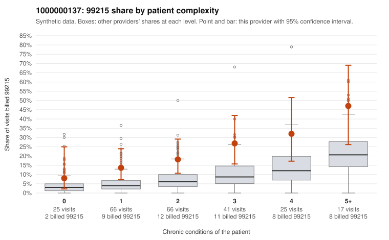

# 1000000137: 1000000137: 1 of 20 documented 99215 claims (5%) are documented below the billed level

**Leaning (advisory):** Pattern consistent with upcoding

## Why

1000000137 billed 99215 on 20.8% of 240 claims against an expected 6.7% given patient complexity (risk-adjusted score 3.29; plain z-score vs peers 2.14). 22% of this provider's 99215 claims were on patients with 0 or 1 chronic conditions. Records came back for 45 claims. Of 20 documented 99215 claims, 1 (5%) were documented below the billed level, against 21% for the comparison providers. Note checks on 45 returned notes (share showing each sign): problems 20%, late 20%, unsigned 0%, data 9%. No audit trail was received. 6 of 34 notes claiming moderate-or-higher data reviewed had no lab or test line on the claim. This pattern is consistent with upcoding. It is a reason to review the records, not a finding. Examples: C0069606: billed 99215, patient aged 75 with 5 chronic condition(s) (hypothyroidism;type 2 diabetes;hypertension;osteoarthritis;chronic kidney disease); documented MDM level moderate, minutes not recorded. C0069391: billed 99215, patient aged 21 with 1 chronic condition(s) (hyperlipidemia). C0069403: billed 99215, patient aged 42 with 1 chronic condition(s) (depression). C0069424: billed 99215, patient aged 43 with 0 chronic condition(s); documented MDM level high, 51 minutes.

## Evidence chart

## Cited claims

`C0069606`, `C0069391`, `C0069403`, `C0069424`

## Suggested next steps

- Request the full charts for C0069606, C0069391, C0069403 and have a certified coder re-score each against the current E/M rules (medical decision making or total time).
- If the re-scoring confirms the pattern, review the random sample in the recovery packet's sampling plan before any overpayment estimate; do not extrapolate from a targeted sample.
- Look at the notes themselves: 20% address fewer problems than their level implies and 20% were signed late; request the audit trail for C0069606, C0069391, C0069403.

---
Citations checked: 4/4 valid. Synthetic data. The leaning is advisory; the flag comes from the statistical screen, and no clinical documentation is available beyond the sampled records-review facts shown in the packet.
