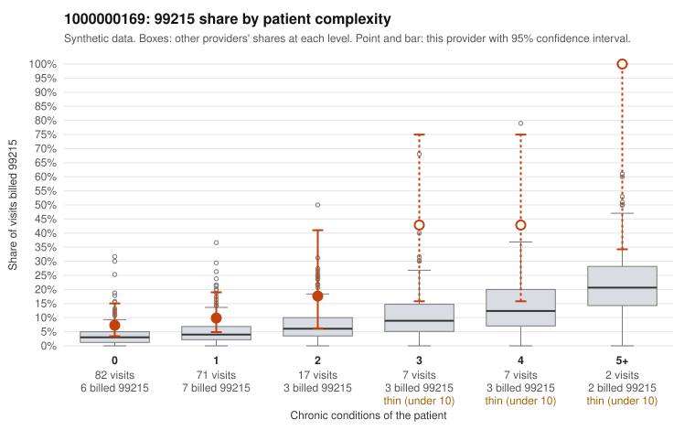

# 1000000169: 1000000169: too few returned records to judge

**Leaning (advisory):** Inconclusive

## Why

1000000169 billed 99215 on 12.9% of 186 claims against an expected 4.1% given patient complexity (risk-adjusted score 2.21; plain z-score vs peers 0.88). 54% of this provider's 99215 claims were on patients with 0 or 1 chronic conditions. Records came back for 30 claims. Of 5 documented 99215 claims, 1 (20%) were documented below the billed level, against 21% for the comparison providers. Note checks on 30 returned notes (share showing each sign): problems 40%, late 7%, unsigned 0%, data 0%. No audit trail was received. 0 of 19 notes claiming moderate-or-higher data reviewed had no lab or test line on the claim. The evidence does not support a call either way yet. Examples: C0085897: billed 99215, patient aged 49 with 1 chronic condition(s) (obesity); documented MDM level moderate, 32 minutes. C0085815: billed 99215, patient aged 72 with 0 chronic condition(s). C0085822: billed 99215, patient aged 32 with 1 chronic condition(s) (COPD); documented MDM level high, 46 minutes.

## Evidence chart

## Cited claims

`C0085897`, `C0085815`, `C0085822`

## Suggested next steps

- 30 charts came back but do not settle it: request a targeted sample of 99215 charts, starting with C0085897, C0085815, C0085822.
- Re-check after the targeted charts arrive; do not call upcoding or a sicker panel on this evidence alone.

---
Citations checked: 3/3 valid. Synthetic data. The leaning is advisory; the flag comes from the statistical screen, and no clinical documentation is available beyond the sampled records-review facts shown in the packet.
