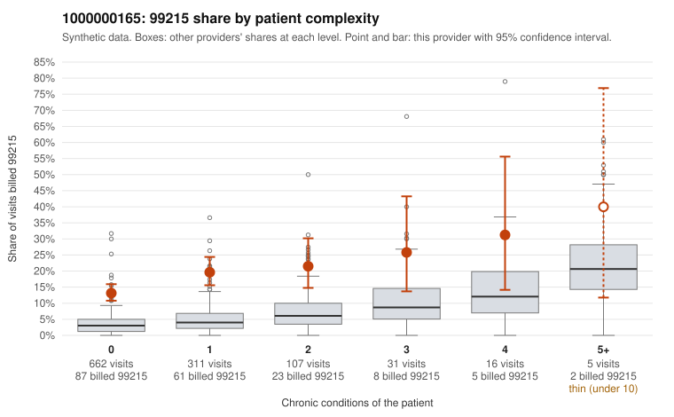

# Payment Integrity dossier: 1000000165

> Draft for human review. Statistical and records-sample evidence only; not a finding. Compliance or legal review is needed before any provider contact, notice or recoupment.

## Provider overview

| | |
|---|---|
| Specialty / state | Family Practice, GA (synthetic) |
| Claims / patients | 1,132 / 547 |
| Billed mix (99211 to 99215) | 23 / 34 / 384 / 505 / 186 |
| 99215 share | 16.4% |
| Expected 99215 share given patient complexity | 3.6% |
| Screen scores | z vs peers 1.44; risk-adjusted 8.88; flagged by eb_ratio_t |

## Case summary (advisory)

**1000000165: 17 of 22 documented 99215 claims (77%) are documented below the billed level**

Leaning: pattern consistent with upcoding. Citations checked: 5/5 valid.

1000000165 billed 99215 on 16.4% of 1,132 claims against an expected 3.6% given patient complexity (risk-adjusted score 8.88; plain z-score vs peers 1.44). 80% of this provider's 99215 claims were on patients with 0 or 1 chronic conditions. Records came back for 45 claims. Of 22 documented 99215 claims, 17 (77%) were documented below the billed level, against 21% for the comparison providers. Note checks on 45 returned notes (share showing each sign): problems 44%, late 4%, unsigned 0%, data 4%. No audit trail was received. 3 of 26 notes claiming moderate-or-higher data reviewed had no lab or test line on the claim. This pattern is consistent with upcoding. It is a reason to review the records, not a finding. Examples: C0084217: billed 99215; documented MDM level moderate, 35 minutes. C0084371: billed 99215; documented MDM level moderate, 33 minutes. C0084380: billed 99215, patient aged 42 with 1 chronic condition(s) (obesity); documented MDM level moderate, 35 minutes. C0084282: billed 99215, patient aged 52 with 0 chronic condition(s). C0084325: billed 99215, patient aged 64 with 1 chronic condition(s) (hypertension).

## Evidence chart

## Records-review sample so far

Documentation is on file for 45 claims (4% of this provider's claims).

| Billed | Documented | Documentation below billed level | Rate | All-provider rate |
|---|---|---|---|---|
| 99213 | 11 | 0 | 0.0% | 2.2% |
| 99214 | 11 | 7 | 63.6% | 8.9% |
| 99215 | 22 | 17 | 77.3% | 20.6% |

## Recommended next steps for Payment Integrity

1. Request records for the sampled claims in `record_request_list.csv` (50 claims across 99215).
2. Review the records against E/M documentation rules and record the supported level for each claim.
3. Run the overpayment estimator on the reviewed sample (`sampling_plan.md` explains how).
4. Notice, appeal rights, recoupment, education or corrective action, and any referral are decisions for the PI team, compliance and counsel. Nothing here drafts those.

Suggested follow-ups from the case summary:

- Request the full charts for C0084217, C0084371, C0084380 and have a certified coder re-score each against the current E/M rules (medical decision making or total time).
- If the re-scoring confirms the pattern, review the random sample in the recovery packet's sampling plan before any overpayment estimate; do not extrapolate from a targeted sample.
- Look at the notes themselves: 44% address fewer problems than their level implies and 4% were signed late; request the audit trail for C0084217, C0084371, C0084380.

## Limits

- Synthetic data; no real claims or providers.
- The leaning is advisory. The flag comes from the statistical screen; the summary explains it.
- The records-review sample is partial and was simulated for this project.
- Allowed amounts are GA Family Practice averages from a public CMS file, not this provider's actual payments.
